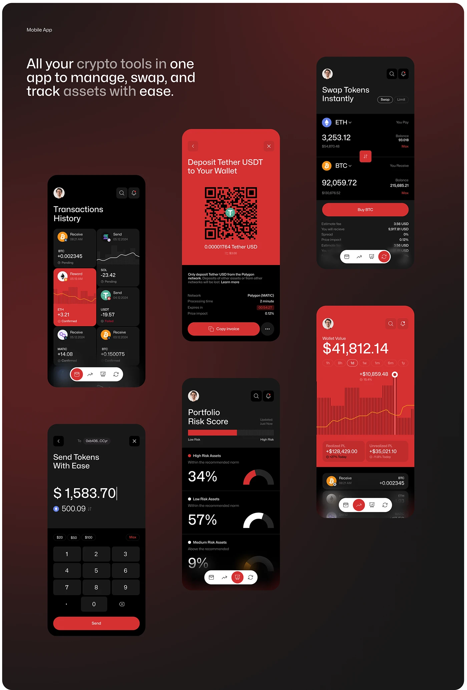

# Red and Black Crypto Screens on Dark Vignette

**Discipline:** app · **Design type:** Fintech app screens
**Tags:** crypto, red, black, screens, wallet, swap, risk, vignette

## What it is
A dark red vignette board with a headline 'All your crypto tools in one app' and seven phones in a scattered grid: transaction history, deposit QR, swap, wallet chart, portfolio risk score and a send keypad, alternating black and red screens.

## What it means
Alternating red and black screens create rhythm, and the vignette keeps the board dramatic.

## Techniques
- Alternating red and black screens
- Staggered columns of phones
- Red striped chart as a signature texture
- Headline with tone shifts
- Consistent pill tab bar across screens

## Best for
- Crypto wallet flow boards
- Dark fintech presentations
- Multi-screen showcases

## Vocabulary
- **Screen constellation** — Phones scattered in staggered columns on one board.
- **Pill tab bar** — A rounded bottom navigation bar.
- **Vignette board** — A presentation with a darkened edge gradient.
