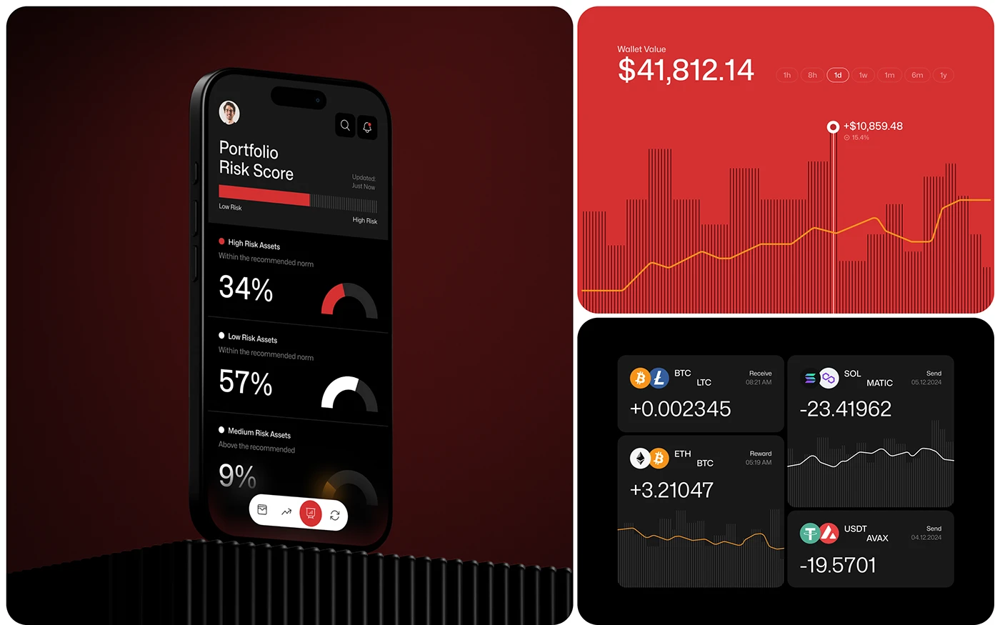

# Red and Black Crypto Risk Screens

**Discipline:** app ·  · **Design style:** Geometric & Bauhaus
**Tags:** crypto, red, black, risk-score, charts, dark, tiles

## What it is
A three-tile board: a phone on a ribbed black plinth with a red gradient backdrop showing a portfolio risk score with donut gauges, a red wallet chart tile with striped bars, and a black tile of coin transaction cards.

## What it means
Red signals risk and energy, and repeating vertical stripe textures gives a cohesive, technical texture across data tiles.

## Techniques
- Striped bar backgrounds as chart texture
- Donut gauges with a bright red arc for risk
- Single red hue across backdrop, UI and chart
- Ribbed plinth echoing the stripe motif
- Paired coin icons per transaction card

## Best for
- Crypto and trading dashboards
- Risk and portfolio visualisation
- Bold dark fintech branding

## Vocabulary
- **Risk gauge** — A donut or bar showing a risk percentage.
- **Stripe texture** — Repeated thin lines used as pattern or bars.
- **Transaction card** — A tile showing a single payment with icon and amount.
