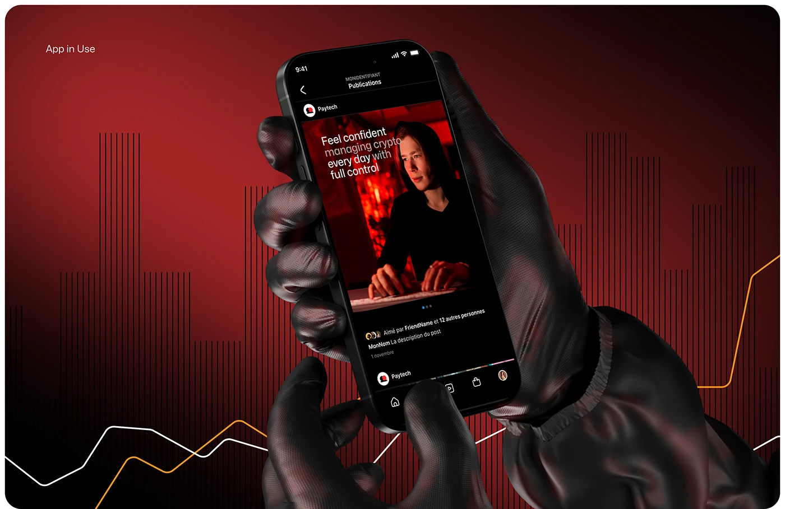

# Black Gloved Hands Holding a Red Social Feed

**Discipline:** app ·  · **Design style:** 3D & Surreal
**Tags:** red, black, gloves, 3d, feed, stripes, line-graph

## What it is
A red-to-black vignette panel with vertical stripe bars and white and orange line graphs, and a phone held by textured black gloves showing a red-lit brand post about managing crypto with full control, labelled 'App in Use'.

## What it means
Glossy gloves are a surreal, cinematic detail, and the striped chart texture ties the setting to finance.

## Techniques
- Rendered gloved hands as a surreal prop
- Stripe chart shapes and lines behind the device
- Red-lit photo inside the screen
- Dimmed words within a white headline
- Small top-left label naming the scene

## Best for
- Crypto and fintech brand presentations
- Dark red mockup scenes
- In-use app imagery

## Vocabulary
- **Gloved hand render** — A 3D hand wearing a glove used as a stylised holder.
- **Brand-lit photo** — A photograph graded in the brand colour.
- **Scene label** — A small caption naming what a panel shows.
