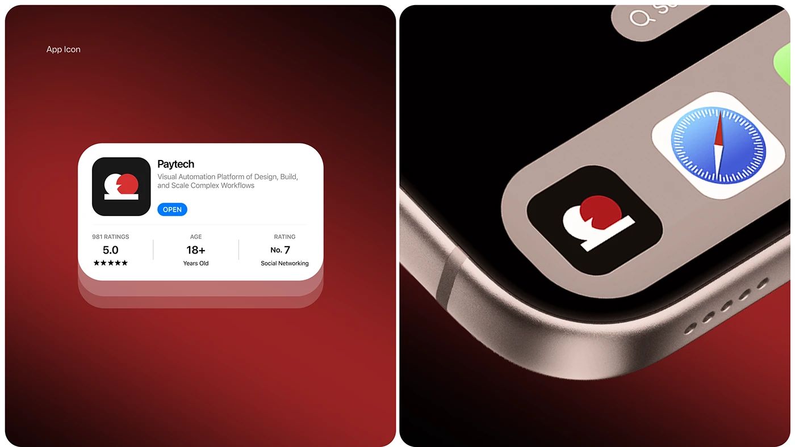

# Red App Icon in Store Listing and Home Screen

**Discipline:** app ·  · **Design style:** 3D & Surreal
**Tags:** app-icon, red, store-listing, close-up, dark, 3d

## What it is
Two rounded panels: a store listing card with a black icon holding a white-and-red mark, rating stats, and a macro shot of the icon beside Safari on a phone corner.

## What it means
The contrast of black and one red disc makes a memorable tiny mark. Showing it in context proves recognition.

## Techniques
- Stacked card edge for depth
- Macro close-up of hardware
- Red vignette background shared across both panels
- Real-world neighbor app (Safari) to test scale
- Simple geometric mark in two colors

## Best for
- App icon reveals
- Brand presentations for apps
- Fintech and automation brands

## Vocabulary
- **Store listing card** — The app-store style card with icon, name, rating and Open button.
- **Macro shot** — An extreme close-up of a small object.
- **Scale test** — Showing a logo beside familiar icons to check legibility.
