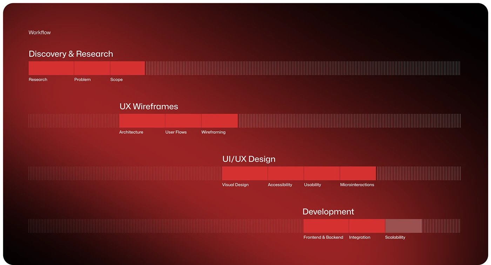

# Red Gradient Workflow Timeline

**Discipline:** app ·  · **Design style:** Geometric & Bauhaus
**Tags:** red, timeline, process, hatch, dark, stages

## What it is
A case-study slide on a deep red vignette showing four workflow phases as staggered horizontal bars: solid red blocks for active steps and fine hatch lines for the remaining track.

## What it means
Staggering the bars makes time visible as progress across the page, and the vignette adds drama to what could be a dry process diagram.

## Techniques
- Staircase of bars where each phase starts where the last ends
- Solid blocks versus fine vertical hatching to show done versus remaining
- Tiny labels under each segment for sub-steps
- Monochrome red with a dark vignette
- Lots of empty space so the timeline reads at a glance

## Best for
- Case study process slides
- Project roadmaps
- Any content with sequential phases

## Vocabulary
- **Staggered timeline** — Bars offset diagonally to suggest sequence.
- **Hatch track** — A field of thin lines used as an empty progress track.
- **Vignette** — A darkening toward the edges of an image.
