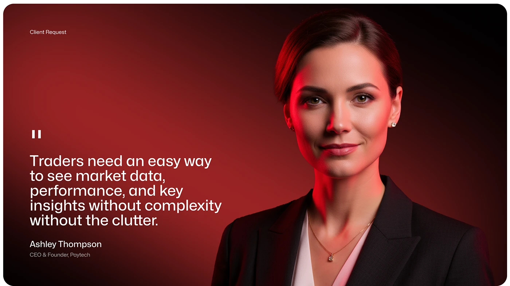

# Red-Lit CEO Quote Client Request

**Discipline:** app ·  · **Design style:** Photographic & Cinematic
**Tags:** quote, portrait, red, dark, client-request, photography, cover

## What it is
A dark red vignette slide with a small 'Client Request' label, a large white quote about traders needing simple data, a name and title, and a professional portrait lit in red at the right.

## What it means
A red-graded portrait keeps the photo on-brand and gives the quote authority.

## Techniques
- Photo graded in the brand red
- Large white quote left, portrait right
- Small caption label top-left
- Quote mark as a simple double bar
- Rounded frame edges with dark vignette

## Best for
- Client request slides
- Testimonials
- Fintech case studies

## Vocabulary
- **Client request** — A slide summarising what the client asked for.
- **Brand grade** — Colour grading a photo to the brand palette.
- **Vignette** — Darkened edges of an image.
