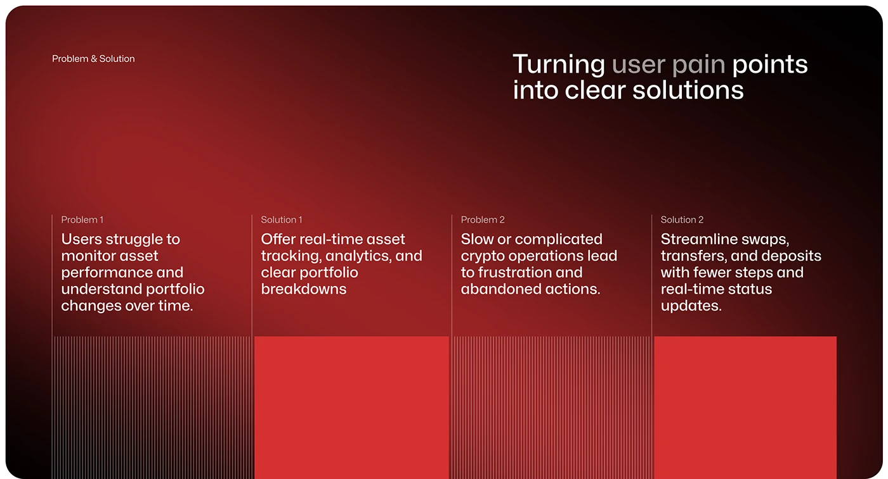

# Red Problem and Solution Columns

**Discipline:** app ·  · **Design style:** Geometric & Bauhaus
**Tags:** problem-solution, red, columns, stripes, blocks, dark, vignette

## What it is
A dark red vignette slide with a headline about turning pain points into solutions and four columns split by hairlines: Problem 1, Solution 1, Problem 2, Solution 2, where problems sit above striped textures and solutions above solid red blocks.

## What it means
Striped versus solid fills visualise messy versus resolved, and column rules keep the comparison tidy.

## Techniques
- Striped texture for problems, solid block for solutions
- Four columns divided by thin vertical lines
- Headline with a dimmed phrase
- Small label above each statement
- Red radial vignette background

## Best for
- Problem and solution slides
- Fintech and crypto case studies
- Two-pair comparisons

## Vocabulary
- **Stripe texture** — Fine vertical lines used as a graphic fill.
- **Solid block** — A flat colour rectangle used as a contrast to texture.
- **Column rule** — A thin line separating columns.
