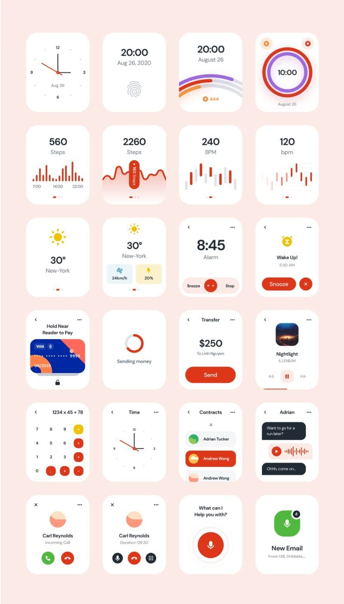

# Red Smartwatch Screens Grid

**Discipline:** app ·  · **Design style:** Geometric & Bauhaus
**Tags:** smartwatch, grid, red, pink, clock, health, widgets

## What it is
A peach sheet with a 4-by-6 grid of white watch faces: clocks, steps, BPM, weather, alarm, payment, music, calculator, contacts, chat and calls, in red, orange and dark navy.

## What it means
One rounded card shape and red accents make many functions read as a single family.

## Techniques
- Uniform grid of watch screens
- Red as the primary action colour
- Big numerals for glanceable data
- Tiny sparkline bars for health
- Consistent icon and button shapes

## Best for
- Wearable UI kits
- Design-system overviews
- Glanceable interface studies

## Vocabulary
- **Watch face** — The main screen of a smartwatch.
- **Glanceable** — Readable in a moment.
- **UI kit grid** — A grid showing many screens or components.
