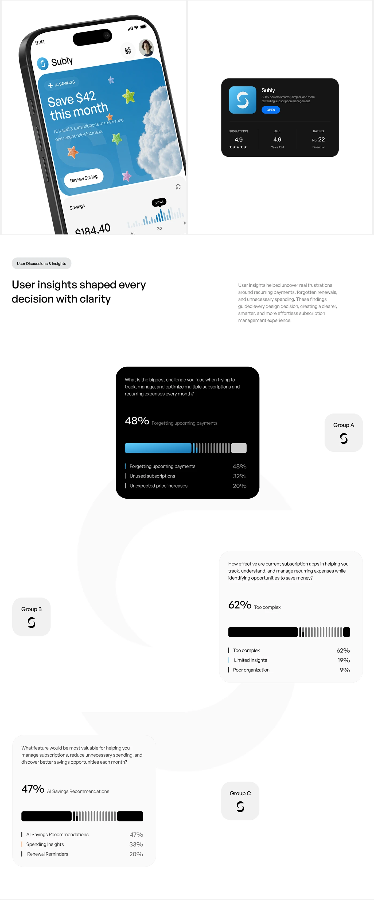

# Research Findings with Black Segmented Bars

**Discipline:** app ·  · **Design style:** Geometric & Bauhaus
**Tags:** research, survey, black, segmented-bar, white, groups, long

## What it is
A tall white sheet with a headline about user insights and three question cards (one black, two white) each with a large percentage and a segmented bar of solid and ticked segments, with Group A, B and C icon tiles and a huge faint logo behind.

## What it means
Segmented bars are compact and tactile, and mixing one dark card with light ones creates rhythm.

## Techniques
- Segmented bars with a solid block then tick marks
- One dark card among light ones
- Big percentage plus a short label
- Group tiles with the brand mark as icons
- Huge faint logo shape behind

## Best for
- Survey result slides
- Research storytelling
- Monochrome data displays

## Vocabulary
- **Segmented bar** — A bar built from solid and ticked segments.
- **Survey card** — A card with a question and its top answers.
- **Faint watermark** — An oversized low-contrast logo behind content.
