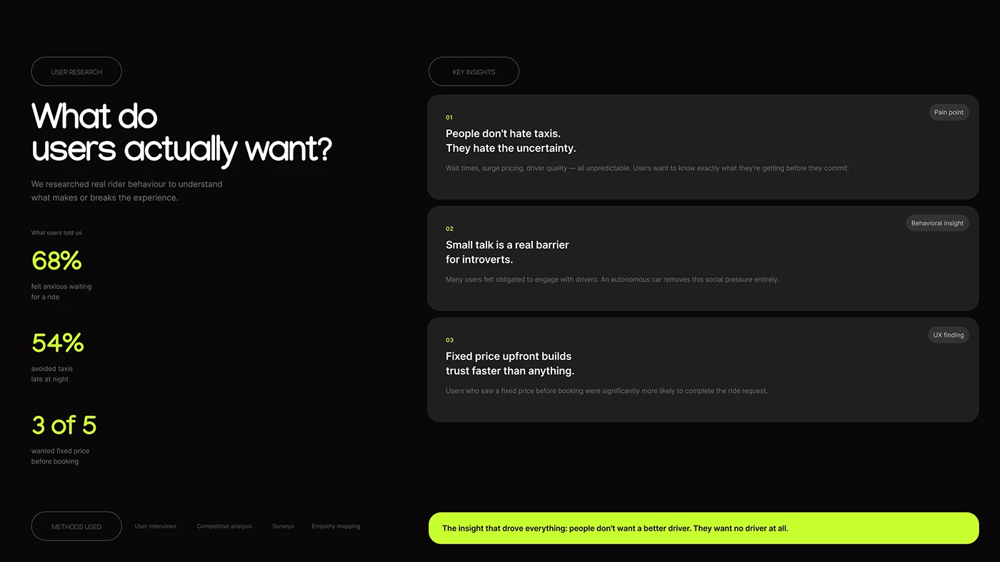

# Black user-research slide with neon lime stats and three dark insight cards

**Discipline:** app · **Design type:** Research insight slide
**Tags:** research, insights, black, neon-lime, stats, cards, pills, case-study

## What it is
A black slide with outlined pills User Research and Key Insights, a big headline 'What do users actually want?', three lime statistics with small captions at left, three dark cards at right numbered 01-03 with tags, a methods row and a lime bar stating the core insight.

## What it means
Sharp and evidence-led; lime numerals draw the eye to the proof.

## Techniques
- Use lime numerals for statistics against black.
- Stack insight cards with a number, bold statement, and grey explanation.
- Tag each card with a small grey pill.
- End with a lime bar summarising the key insight.

## Best for
- UX research summaries
- Dark case-study decks
- Neon-accent brands

## Vocabulary
- **Insight card** — A card presenting one finding.
- **Neon stat** — A large statistic in a bright colour.
- **Insight bar** — A highlighted strip stating the main takeaway.
- **Methods row** — A line listing research methods.
