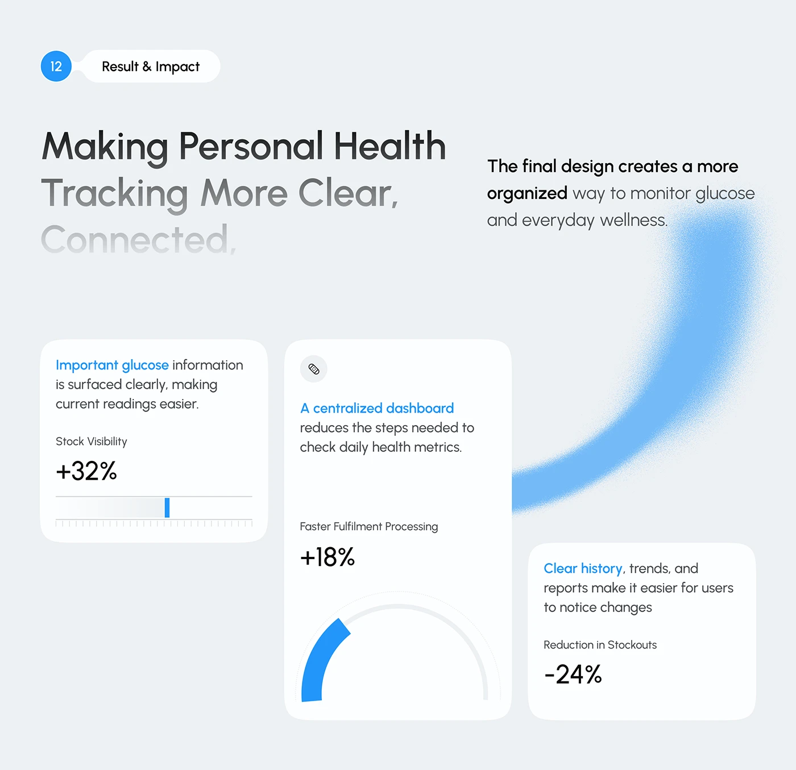

# Result and Impact with Blue Spray Arc

**Discipline:** app · **Design type:** Research insight slide
**Tags:** results, stats, blue, spray, cards, gauge, light

## What it is
A pale slide with a numbered Result & Impact pill, a large headline fading from black to grey, a grainy blue spray-painted arc sweeping down the right and three white stat cards with percentages, a tick slider and a half gauge.

## What it means
The airbrushed arc adds a human, energetic gesture to clean data, and each stat card has its own small graphic.

## Techniques
- Grainy spray arc as a decorative sweep behind cards
- Headline that fades line by line
- Blue highlight on key phrases inside cards
- Different mini graphics per stat (slider, gauge)
- Cards at staggered heights

## Best for
- Results and impact slides
- Health-tech case studies
- Adding warmth to data pages

## Vocabulary
- **Spray arc** — A soft grainy curved stroke that looks airbrushed.
- **Tick slider** — A ruler-like scale with one marked value.
- **Stat card** — A card built around one figure and caption.
