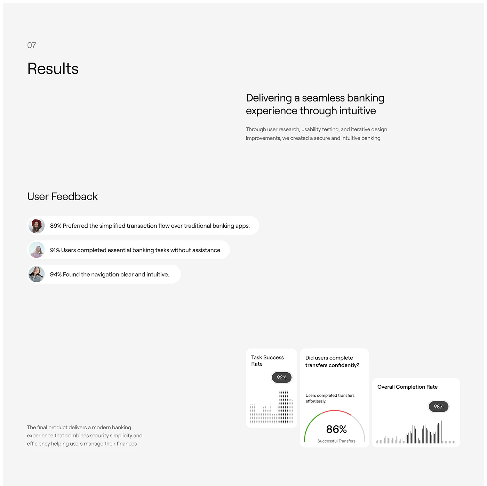

# Results slide with feedback pills and dot-matrix charts

**Discipline:** app ·  · **Design style:** Corporate & Clean-Tech
**Tags:** case-study, results, light-grey, pills, dot-matrix, gauge, banking

## What it is
A pale grey slide numbered 07 with a light headline. User feedback is set as three white capsule bubbles with avatars, and three small white cards at the bottom show a dot-matrix bar chart, a semicircle gauge (86%) and a thin-line bar chart, each with a dark pill percentage.

## What it means
Reassuring and clean; results feel measured and humane thanks to the pills and tiny charts.

## Techniques
- Show quotes as chat-like capsules with a circular avatar.
- Draw charts from dots or thin lines rather than fills.
- Use dark rounded pills for headline percentages.
- Stagger cards at different heights.

## Best for
- Case-study results slides
- Fintech portfolios
- Reporting test outcomes

## Vocabulary
- **Feedback capsule** — A rounded bubble holding a short quote with an avatar.
- **Dot-matrix chart** — A bar chart made of a grid of dots.
- **Stat pill** — A dark rounded label with a percentage.
- **Results slide** — A slide summarising outcomes.
