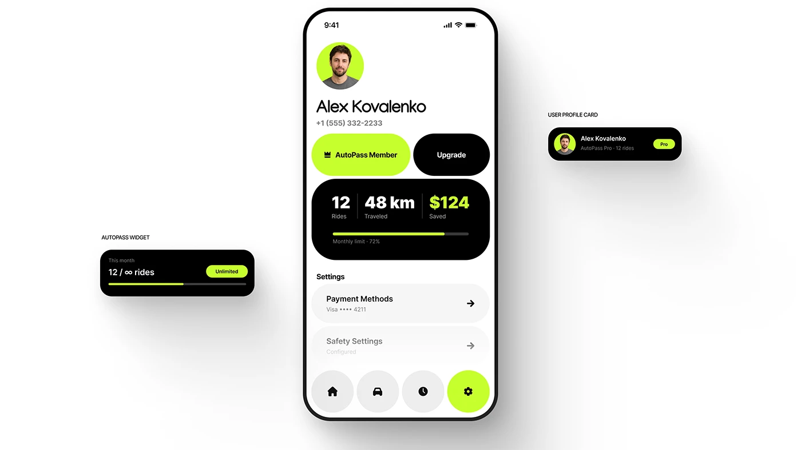

# Profile screen with lime avatar, pill buttons, black stat block and side widgets

**Discipline:** app · **Design type:** Ride-hailing app
**Tags:** profile, lime, black, pills, stats, widgets, circular-nav, white

## What it is
A white phone with a lime-circle avatar, big name, two big pill buttons (lime member, black upgrade), a black rounded stat block with 12 rides, 48 km, $124 in white and lime, settings rows, and a bottom nav of circular buttons with the active lime one. Two labelled black widgets float at the sides.

## What it means
Bold, friendly and legible; very round shapes and lime-on-black feel modern and gamified.

## Techniques
- Use extremely rounded buttons and cards throughout.
- Display stats in a black block with one lime number.
- Make bottom nav a row of round buttons with the active one in lime.
- Show widgets beside the phone with small caps labels.

## Best for
- Mobility and membership apps
- Profile and account screens
- Neon accent brands

## Vocabulary
- **Pill button** — A fully rounded rectangular button.
- **Stat block** — A dark card with several key numbers.
- **Round nav** — A navigation of circular buttons.
- **Widget callout** — A labelled component shown beside the device.
