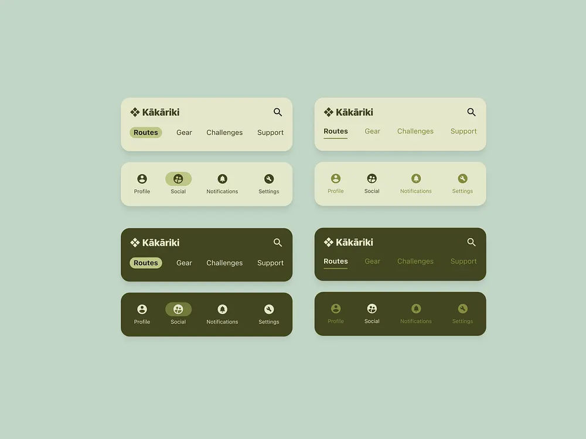

# Sage and Olive Navigation Bar Variants

**Discipline:** app ·  · **Design style:** Warm & Organic
**Tags:** navigation, sage, olive, green, light-dark, tabs, logo, icons

## What it is
Eight rounded navigation cards on a pale sage field: light cream and dark olive versions of a top bar with a logo, search and text tabs (Routes highlighted as a pill or underlined) and an icon tab bar (Profile, Social, Notifications, Settings) with the active item in a pill or bolder tone.

## What it means
A single earthy green family across light and dark variants feels natural and cohesive, and pill versus underline shows two ways to mark active.

## Techniques
- Light and dark versions in one family of greens
- Active tab as a pill or as an underline
- Text tabs and icon tabs as separate variants
- Soft shadows on rounded cards
- Logo and search in the top bar

## Best for
- Navigation component documentation
- Outdoor and nature brand systems
- Monochrome-green UI

## Vocabulary
- **Pill active state** — A filled rounded shape behind the selected tab.
- **Underline active state** — A line under the selected tab.
- **Tonal palette** — A palette built from shades of one hue.
