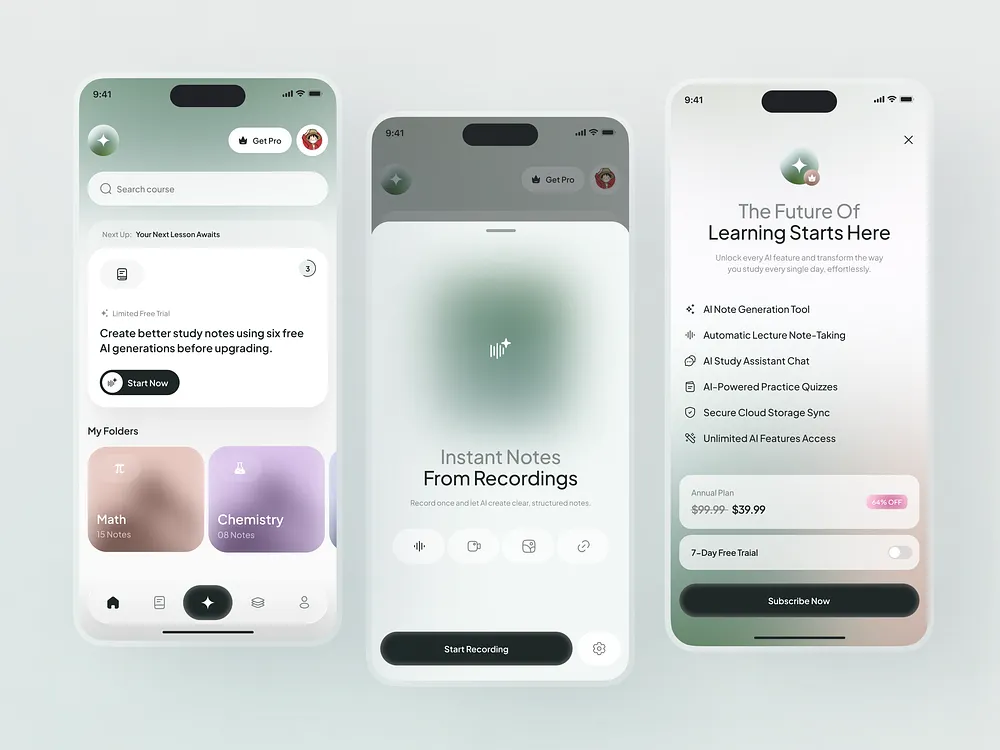

# Sage Glass AI Study Notes Screens

**Discipline:** app · **Design type:** Education app screens
**Tags:** education, ai, sage, glass, frosted, notes, paywall

## What it is
Three phones on a pale ground: a study home with a trial card and pastel folders, a recording sheet with a soft green blur orb, and a paywall listing AI features with pricing and a dark subscribe button.

## What it means
Frosted blurs and muted sage feel calm and focused, ideal for study, and the dark buttons give clear stopping points.

## Techniques
- Blurred colour orb as the hero graphic on the recording screen
- Pastel blurred folder tiles with tiny icons
- Dark pill as the sole high-contrast action
- Bottom sheet that dims the screen behind
- Two-tone titles with grey first line

## Best for
- Education and productivity apps
- AI note-taking tools
- Paywall and upsell screens

## Vocabulary
- **Blur orb** — A soft blurred blob used as an abstract illustration.
- **Bottom sheet** — A panel that slides up from the bottom of a screen.
- **Paywall** — A screen that offers a paid plan.
