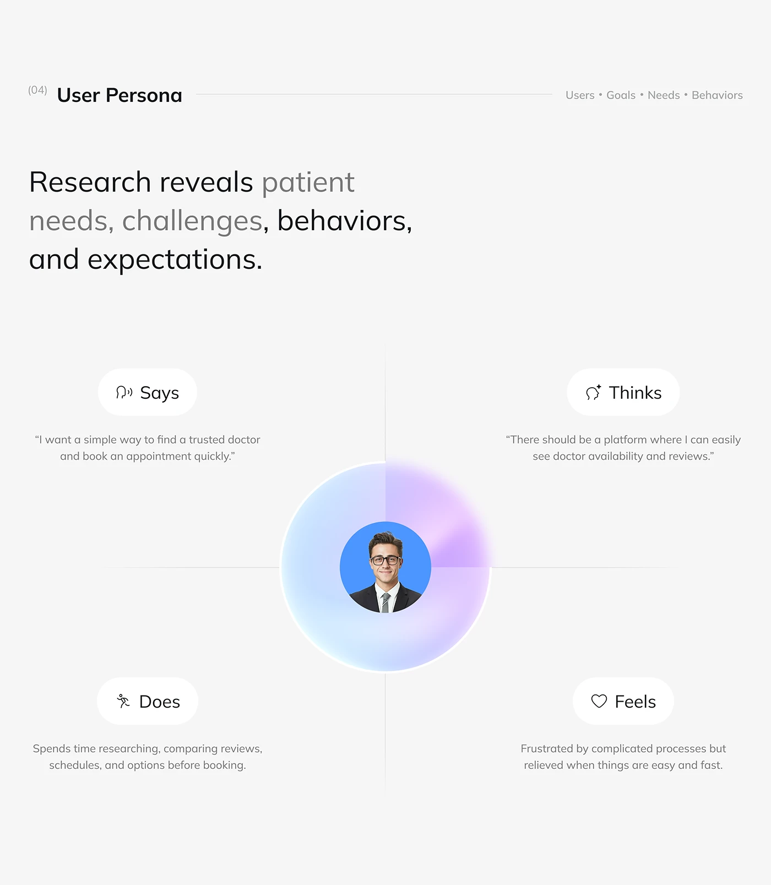

# Says, Thinks, Does, Feels Persona Quadrant

**Discipline:** app · **Design type:** Research insight slide
**Tags:** persona, empathy-map, quadrant, orb, grey, quotes, health

## What it is
A light grey slide titled User Persona with a headline that shifts from grey to black, and an empathy map of four icon pills (Says, Thinks, Does, Feels) with short texts around a central gradient orb holding a portrait, divided by crosshair lines.

## What it means
The orb at the centre puts the person first, and four quadrants organise insights cleanly.

## Techniques
- Crosshair lines dividing four quadrants
- Gradient orb behind the central portrait
- Icon pills naming each quadrant
- Short quotes in small grey text
- Headline with tone shifts

## Best for
- Empathy maps
- User persona slides
- Quadrant diagrams

## Vocabulary
- **Empathy map** — A four-part diagram of what a user says, thinks, does and feels.
- **Quadrant layout** — A page divided into four equal areas.
- **Centre orb** — A glowing circle placed at the heart of a diagram.
