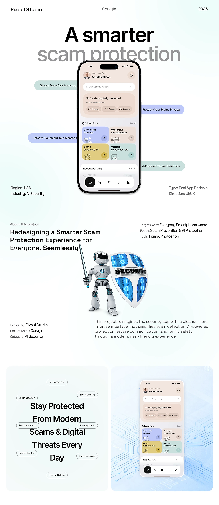

# Scam Protection Long-Scroll Case Study

**Discipline:** app · **Design type:** Case study slide
**Tags:** security, long-scroll, pastel, pills, robot, case-study, light-gradient

## What it is
A tall pastel case study for a scam-protection app: a huge two-tone headline over a phone with floating pastel feature pills, project metadata, a 3D robot knight with a security shield, and a text cloud around 'Stay Protected From Modern Scams'.

## What it means
Soft mint and lavender pills soften a scary topic, while the playful robot adds personality and reassurance.

## Techniques
- Headline partly hidden behind the phone for depth
- Feature pills at different heights orbiting the device
- Pastel quick-action tiles inside the UI
- Tag cloud arranged around a centred statement
- 3D character illustration as a mascot

## Best for
- Security and safety apps
- Long-scroll app case studies
- Friendly takes on serious problems

## Vocabulary
- **Feature pill** — A rounded label naming a feature, floated near a device.
- **Tag cloud** — Words in pills scattered around a central statement.
- **Mascot illustration** — A character used to humanise a product.
