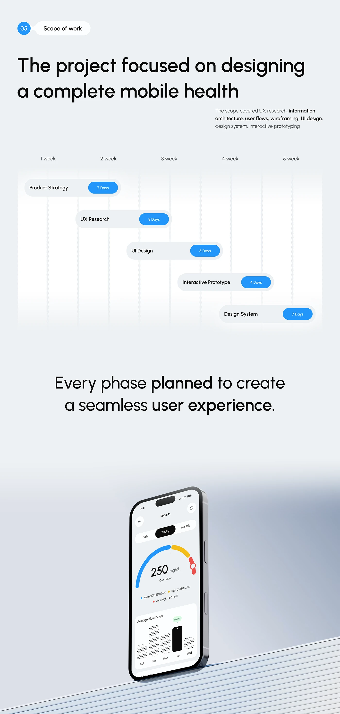

# Scope of Work Gantt Staircase with Day Pills

**Discipline:** app · **Design type:** Process slide
**Tags:** scope, gantt, timeline, blue-pills, weeks, health, tilted-phone

## What it is
A pale slide with a numbered Scope of work pill, a large headline, a small paragraph, a five-week header and a descending staircase of five capsules (Product Strategy, UX Research, UI Design, Interactive Prototype, Design System) each with a blue days pill, then a statement and a tilted phone on a striped ledge.

## What it means
A stepped capsule chart makes the schedule simple, and blue day pills make durations scannable.

## Techniques
- Capsules stepping down across week columns
- Blue pill for days inside each capsule
- Faint vertical week grid
- Bold phrases inside a large statement
- Phone on a striped ledge as a closing visual

## Best for
- Project schedules
- Scope and timeline slides
- Gantt-like summaries

## Vocabulary
- **Capsule bar** — A rounded bar representing a task in a timeline.
- **Days pill** — A small blue label with a duration in days.
- **Week columns** — Faint vertical divisions for weeks.
