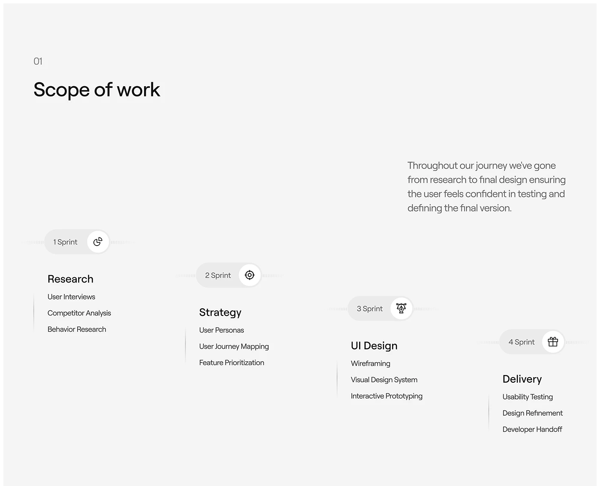

# Scope-of-work slide with stepped sprint pills and task lists descending to the right

**Discipline:** app ·  · **Design style:** Minimalist
**Tags:** process, timeline, light-grey, sprints, icons, stepped, minimal, case-study

## What it is
A light grey slide with '01', 'Scope of work', a short paragraph and four stepped sprint capsules (Research, Strategy, UI Design, Delivery) each with an icon in a white circle, faint tick lines and a short list of tasks under a bold title, descending diagonally.

## What it means
Clear and calm; the staircase shows progress without clutter.

## Techniques
- Step phases diagonally downward.
- Use pills with an icon circle as phase labels.
- List tasks as plain lines with a thin vertical rule.
- Keep the palette to grey and black.

## Best for
- Scope and methodology slides
- Agency process pages
- Minimal grey decks

## Vocabulary
- **Sprint pill** — A capsule labelling a phase with an icon.
- **Staircase layout** — Items stepped diagonally.
- **Fade ticks** — Dotted lines fading at the ends of a pill.
- **Task list** — Short lines under a phase title.
