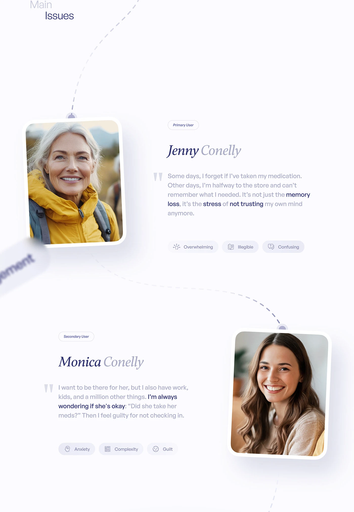

# Primary and Secondary Personas on a Dashed Path

**Discipline:** app ·  · **Design style:** Editorial
**Tags:** persona, serif-italic, dashed-path, portraits, quotes, pills, white

## What it is
A white page titled 'Main Issues' with two tilted portrait cards hanging from a curving dashed path, each with a role pill, an italic serif name, a quote with key words darker, and three icon pill tags for feelings.

## What it means
Portraits hanging like tags along a path make personas feel like a story, and italic names add warmth.

## Techniques
- Tilted framed portraits pinned to a dashed path
- Italic serif names beside sans quotes
- Key phrases darker within a grey quote
- Icon pills naming emotions
- Alternating left and right layout

## Best for
- Persona presentations
- Care and health research
- Story-led UX documentation

## Vocabulary
- **Primary user** — The main person the product is designed for.
- **Secondary user** — Someone affected by or supporting the primary user.
- **Emotion pill** — A small tag naming a feeling with an icon.
