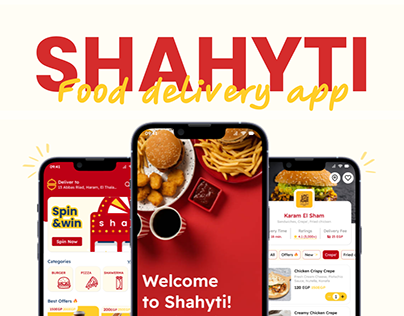

# Shahyti food delivery app cover with giant red caps, yellow script overlay and three phones

**Discipline:** app · **Design type:** Food ordering app · **Design style:** Playful & Illustrated
**Tags:** food-delivery, red, yellow, script, case-study-cover, burger

## What it is
A cream cover with huge red 'SHAHYTI' caps overlapped by a yellow handwritten 'Food delivery app', and three phones: a home screen with 'Spin & win', a red welcome screen with fried chicken and fries, and a restaurant menu screen, with yellow sparkle doodles.

## What it means
Hungry and fun; the red and yellow fast-food palette and script feel lively and local.

## Techniques
- Overlap a script tagline across bold caps.
- Put the splash screen in the centre phone.
- Add doodle sparkles around devices.

## Best for
- Food delivery apps
- Restaurant apps
- Case study covers

## Vocabulary
- **Splash screen** — The first branded screen when an app opens.
- **Script overlay** — Handwritten text layered across other type.
