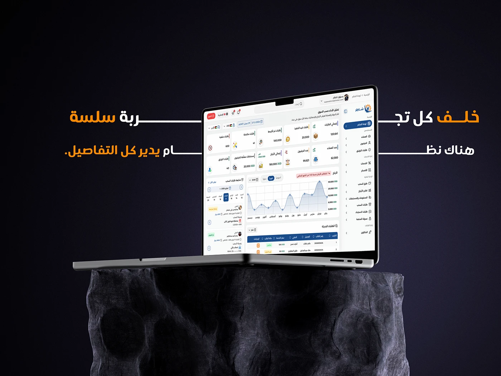

# Shater admin dashboard: Arabic RTL analytics on a floating laptop over a dark rock plinth

**Discipline:** app · **Design type:** Dashboard · **Design style:** Dark & Neon
**Tags:** dashboard, arabic, rtl, dark, laptop-mockup, marketplace

## What it is
A dark navy cover with a huge cropped orange-and-white Arabic headline, a laptop floating above a rough stone plinth showing an RTL admin dashboard with stat cards, a line chart and order tables, and the Shater logo top-right.

## What it means
Powerful and grounded; the stone plinth gives a data dashboard unexpected weight and drama.

## Techniques
- Float a device above an unexpected material plinth.
- Crop a bold headline at the frame edges.
- Mirror dashboard layout for RTL reading.

## Best for
- Admin dashboard covers
- Arabic SaaS products
- Dramatic device mockups

## Vocabulary
- **RTL** — Right-to-left layout for languages like Arabic.
- **Plinth** — A base or pedestal displaying an object.
