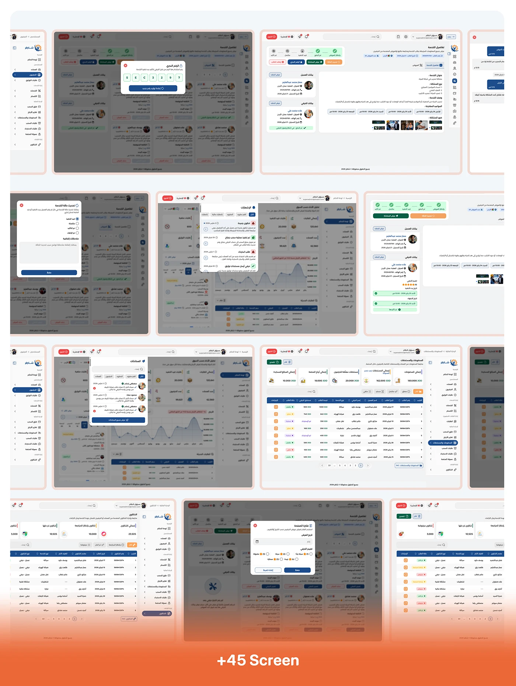

# Shater admin dialogs grid: dimmed background screens with OTP, confirmation and edit modals

**Discipline:** app · **Design type:** UX documentation · **Design style:** Corporate & Clean-Tech
**Tags:** admin-panel, modal, arabic, dialog, orange, screens-grid

## What it is
A grid of ten dimmed admin desktop screens, each with a centred white modal in front: an OTP confirmation, a suspend-account form, a confirm-and-notify dialog, a rating breakdown, financial reports and a request-cancellation form, closing in an orange '+45 Screen' banner.

## What it means
Rigorous and complete; documenting every dialog state shows the admin experience was designed screen by screen, not assumed.

## Techniques
- Dim the background to focus attention on the modal.
- Vary modal content to cover many real admin actions.
- Close a documentation grid with a total screen-count banner.

## Best for
- Admin dialog documentation
- Design system modal libraries
- Large platform case studies

## Vocabulary
- **Dimmed background** — A darkened backdrop used to focus on a foreground modal.
- **Confirmation dialog** — A modal asking the user to confirm an action.
