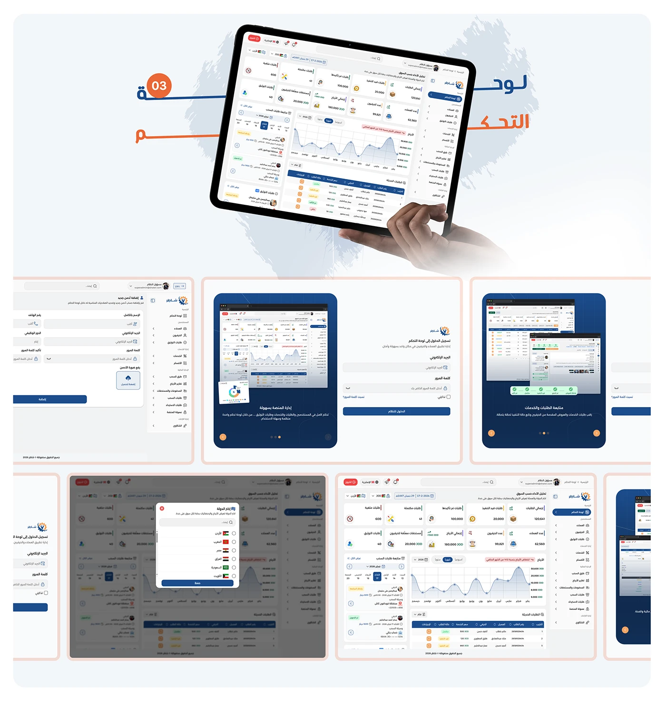

# Shater control panel: tablet hero with a country-selector modal and a grid of admin sub-screens

**Discipline:** app · **Design type:** UX documentation · **Design style:** Corporate & Clean-Tech
**Tags:** admin-panel, arabic, modal, tablet, orange, country-selector

## What it is
A light page with a big orange-and-navy 'لوحة التحكم' title, a tablet held in a hand showing the dashboard, and a grid of six framed admin screens including a new-admin form, a country-selection modal with flag radio buttons, a delete-confirmation dialog and further dashboard variants.

## What it means
Detail-oriented; surfacing modals and edge-case dialogs shows the admin panel was designed beyond the happy path.

## Techniques
- Include modals and dialogs, not just base screens.
- Use flag radio buttons for a country selector.
- Frame every admin screen in a consistent outlined card.

## Best for
- Admin panel documentation
- Modal and dialog design
- B2B platform case studies

## Vocabulary
- **Modal** — A dialog that appears over the current screen and blocks interaction.
- **Radio button** — A control for picking exactly one option from a list.
