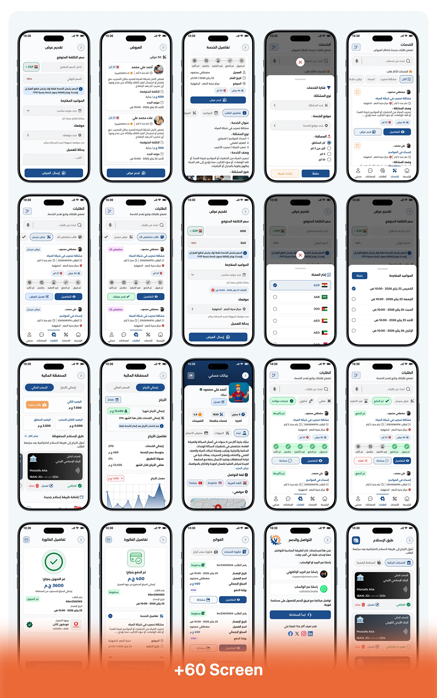

# Shater admin panel: six framed desktop screens of customer, craftsman and verification data tables

**Discipline:** app · **Design type:** UX documentation · **Design style:** Corporate & Clean-Tech
**Tags:** admin-panel, arabic, rtl, data-table, desktop, dashboard

## What it is
A 3x2 grid of rounded desktop screenshots in the admin RTL panel: a customer list table, a customer detail profile with stats, a craftsman list with ratings and status dots, a verification request review with uploaded documents, and two more list/detail pairs, each in a thin pink-outlined frame.

## What it means
Operationally serious; dense RTL tables show the back-office tools needed to actually run a marketplace.

## Techniques
- Frame each admin screen with a thin coloured outline.
- Pair a list view with its matching detail view.
- Use status dots for quick state scanning in tables.

## Best for
- Admin panel case studies
- B2B back-office design
- RTL dashboard documentation

## Vocabulary
- **Data table** — Rows and columns showing structured records.
- **Status dot** — A small coloured circle indicating a state.
