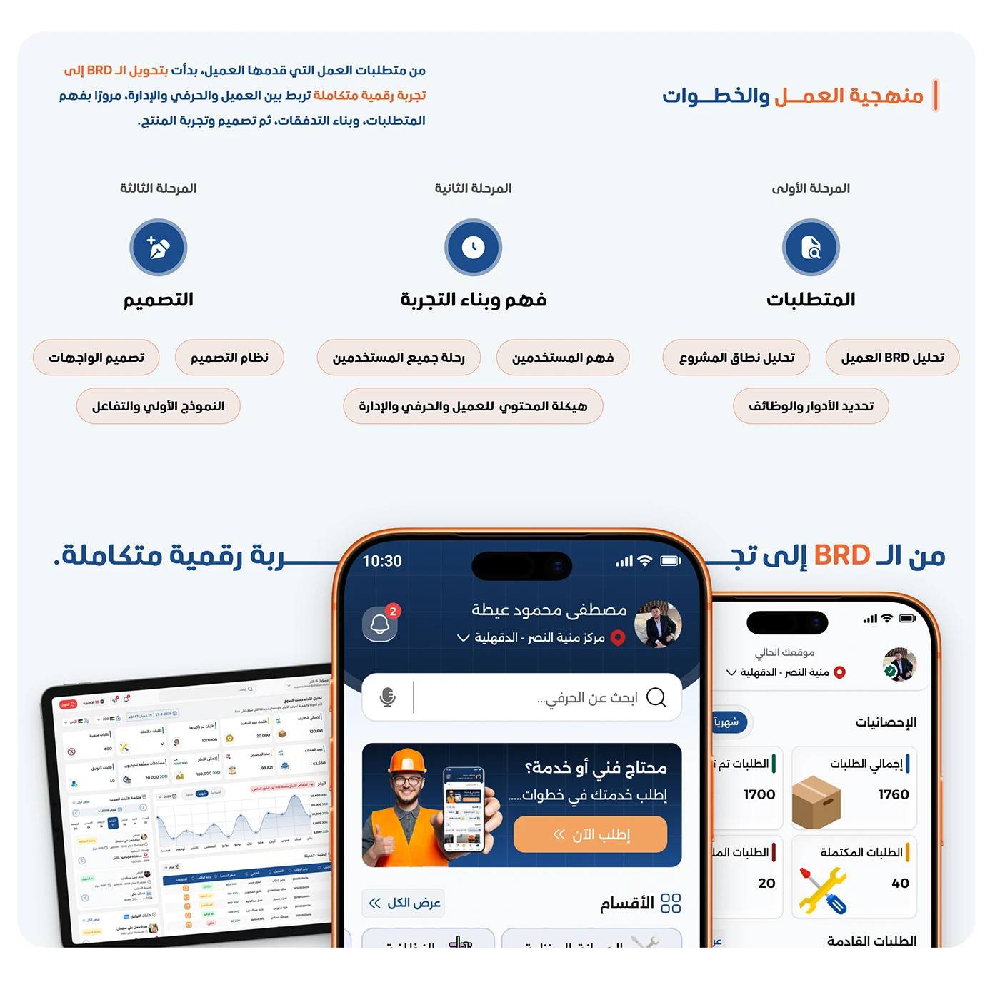

# Shater admin persona 'the mind managing the system' key needs with a full desktop analytics screen

**Discipline:** app · **Design type:** Case study slide · **Design style:** Corporate & Clean-Tech
**Tags:** persona, admin, arabic, key-needs, dashboard, orange

## What it is
A pale blue slide numbered 03 with 'لوحة التحكم — العقل المدبر للمنظومة' (Control Panel — the mind managing the system), five pill needs (handling complaints, managing services, managing users and craftsmen, tracking orders, managing payments), a faded 'Shater' wordmark, and a full desktop dashboard screenshot with stat cards, a chart and a sidebar.

## What it means
Systems-level and confident; treating the admin as a persona too completes the three-sided user picture.

## Techniques
- Treat the internal operator as a persona, same as external users.
- Close a three-persona set with a summary line.
- Show the admin's real screen at full desktop size.

## Best for
- Admin UX research
- Three-sided platform design
- B2B dashboard case studies

## Vocabulary
- **Internal user** — A persona who operates rather than uses the product externally.
- **Sidebar navigation** — A vertical menu along a dashboard's edge.
