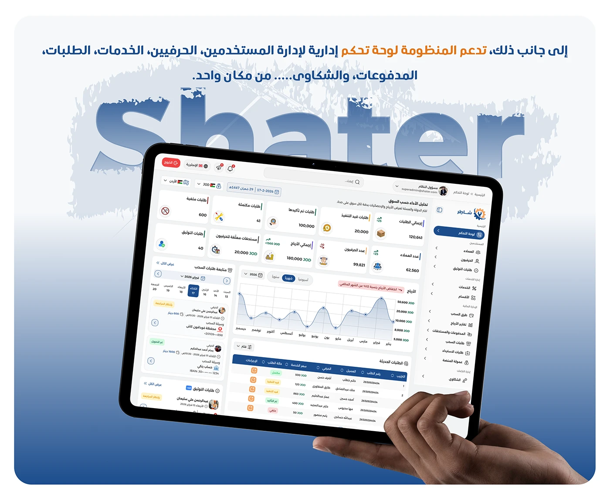

# Shater admin scope statement on blue with a highlighted phrase and a tablet held in hand

**Discipline:** app · **Design type:** Case study slide · **Design style:** Corporate & Clean-Tech
**Tags:** admin-panel, arabic, scope, blue, tablet, case-study

## What it is
A blue slide with an Arabic sentence stating the system also supports a control panel for managing users, craftsmen, services, orders, payments and complaints — with 'إدارة تحكم' (management panel) highlighted in white — above a faded 'Shater' wordmark and a hand holding a tablet with the dashboard.

## What it means
Reinforcing; restating the admin scope in plain language after the detailed slides drives home how much the panel covers.

## Techniques
- Highlight the key phrase in a summary sentence.
- Repeat a scope statement in different visual contexts for emphasis.
- Keep the same wordmark watermark across related slides.

## Best for
- Case study scope summaries
- Admin capability statements
- Recap slides

## Vocabulary
- **Watermark** — A faint background mark, often a logo or wordmark.
- **Scope statement** — A sentence defining what a system covers.
