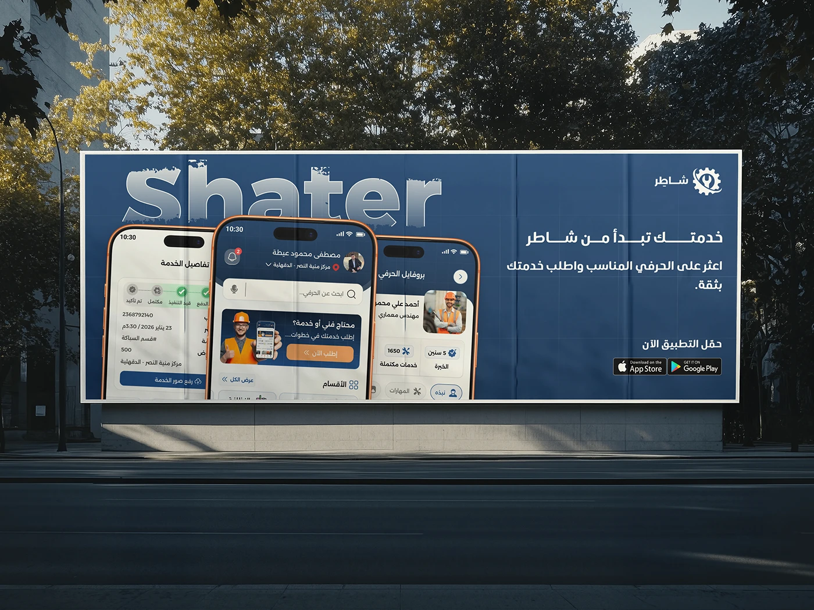

# Shater outdoor billboard mockup: 'Your services start from Shater' with stacked phone screens at dusk

**Discipline:** app · **Design type:** App store presentation · **Design style:** Photographic & Cinematic
**Tags:** billboard, outdoor-ad, arabic, navy, mockup, marketing

## What it is
A photo-realistic street billboard at dusk in navy with a weathered 'Shater' wordmark, an Arabic headline 'خدمتك تبدأ من شاطر' (Your service starts from Shater), a supporting line, App Store and Google Play badges, and three stacked phone screens showing the app in front of the sign.

## What it means
Aspirational and real-world; an outdoor ad mockup extends the brand from screens into the physical city.

## Techniques
- Mock the brand onto real-world outdoor media.
- Weather the wordmark texture for authenticity.
- Angle phone screens in front of the billboard for scale.

## Best for
- Marketing campaign mockups
- Brand launch presentations
- Outdoor advertising concepts

## Vocabulary
- **Billboard mockup** — A realistic preview of an ad on outdoor signage.
- **Weathering** — Adding wear texture for realism.
