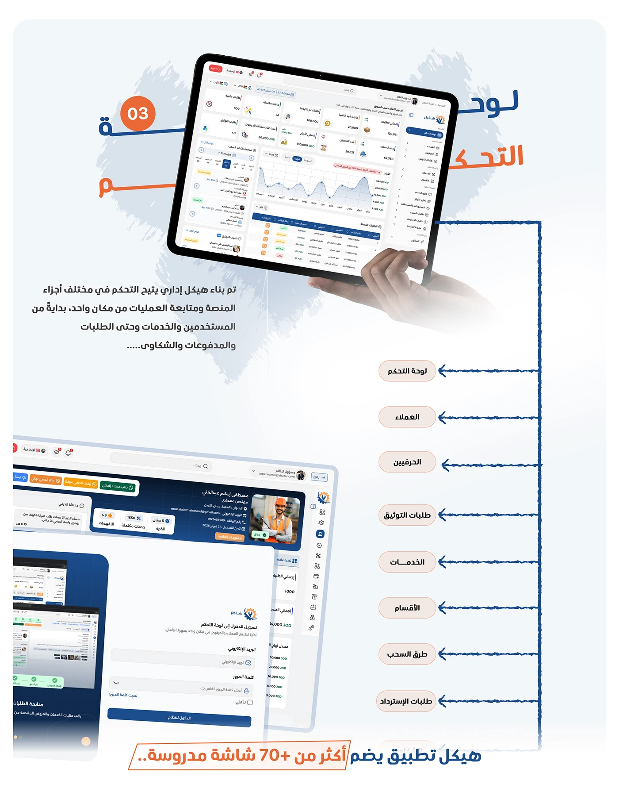

# Shater 'Control Panel' structure: tablet dashboard linked to a vertical list of admin sections

**Discipline:** app · **Design type:** UX documentation · **Design style:** Corporate & Clean-Tech
**Tags:** dashboard, arabic, information-architecture, tablet, blue, admin

## What it is
A light page with a big orange-and-navy Arabic 'لوحة التحكم' (Control Panel) title, a hand holding a tablet showing the admin dashboard, an explanatory Arabic paragraph, and a vertical list of pill-labelled sections (Dashboard, Customers, Craftsmen, Verification Requests, Services, Departments, Withdrawal Methods, Refund Requests) each linked by a dotted line, closed with '+70 screens' claim.

## What it means
Reassuringly thorough; listing every admin section with a line to the hub proves depth of scope.

## Techniques
- List every module as a pill linked to the hub screen.
- State a total screen count as a scale claim.
- Use a tablet-in-hand mockup for the main view.

## Best for
- Admin panel case studies
- Platform scope slides
- B2B dashboard documentation

## Vocabulary
- **Module list** — Every functional section of an admin system.
- **Scale claim** — A number used to show a project's size.
