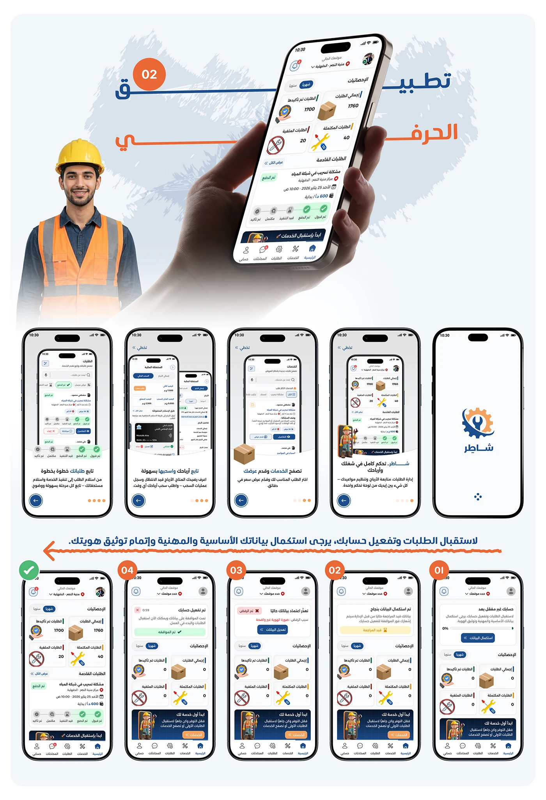

# Shater craftsman app hero with a phone in hand, followed by five onboarding and identity-verification screens

**Discipline:** app · **Design type:** Onboarding screens · **Design style:** Corporate & Clean-Tech
**Tags:** onboarding, arabic, verification, hand-mockup, orange, identity

## What it is
A light page with the 'تطبيق الحرفي' hero (phone in hand over a hard-hat photo) above five app screens (order tracking steps, chat, an empty package illustration, service browsing, a splash logo), then a row of four numbered identity-verification steps (Complete Data, Verify Account, Personal Data, Professional Data) with a green checkmark for accepted accounts.

## What it means
Trust-building and thorough; a numbered verification flow shows how the platform screens craftsmen before letting them work.

## Techniques
- Number onboarding steps for clarity.
- Use an empty-state illustration for a no-content moment.
- Mark the final accepted state in green.

## Best for
- Marketplace onboarding
- Identity verification flows
- Two-sided platform apps

## Vocabulary
- **Empty state illustration** — An image shown when there is nothing to display yet.
- **Identity verification** — Confirming a user's real identity before granting access.
