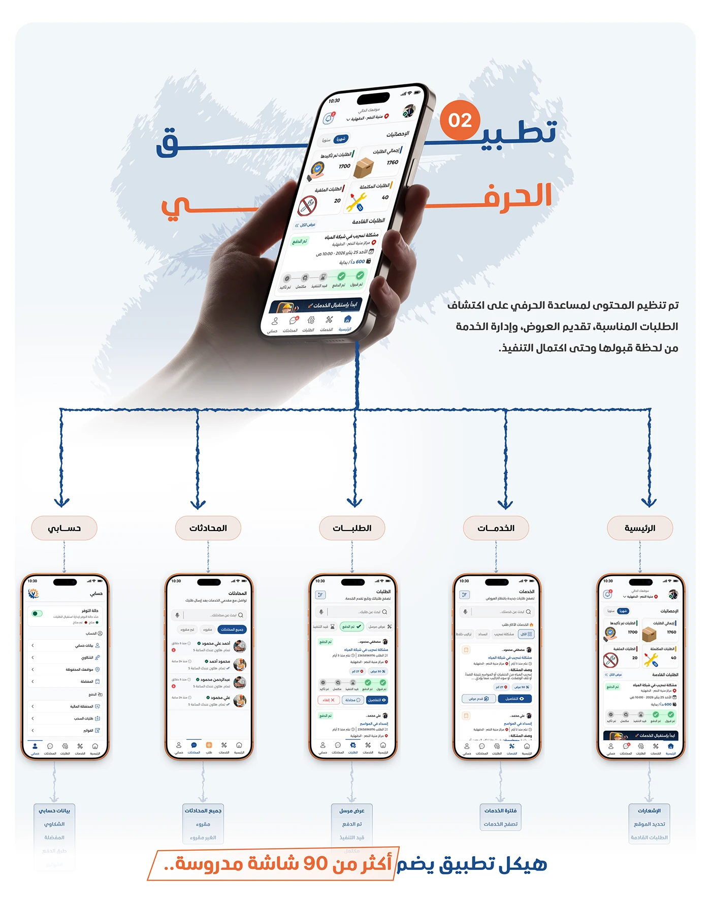

# Shater craftsman app sitemap: five modules branching from a hand-held phone with a '90 screens' claim

**Discipline:** app · **Design type:** UX documentation · **Design style:** Corporate & Clean-Tech
**Tags:** sitemap, arabic, information-architecture, hand-mockup, blue, orange

## What it is
A light page with a big orange-and-navy 'تطبيق الحرفي' (Craftsman App) title numbered 02, a hand holding a phone showing the dashboard, five module pills (Account, Conversations, Orders, Services, Home) each linked down by dotted lines to a phone screen and a caption, closing with '+90 screens'.

## What it means
Systematic and reassuring; branching from one hero phone to five modules maps the whole app clearly.

## Techniques
- Branch a sitemap from a single hero device.
- Number each app in a multi-app platform.
- Caption each screen with its sub-features.

## Best for
- Multi-role platform case studies
- Sitemaps
- App structure documentation

## Vocabulary
- **Sitemap** — A diagram of an app or site's screens and structure.
- **Module** — A distinct functional section of an app.
