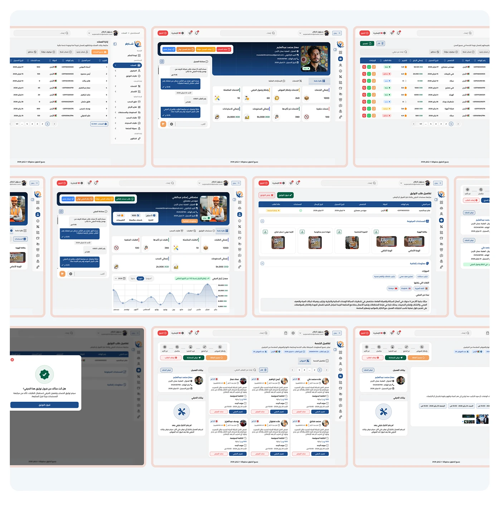

# Shater 'Client' persona key needs slide with a man in a keffiyeh and two Arabic phone screens

**Discipline:** app · **Design type:** Case study slide · **Design style:** Corporate & Clean-Tech
**Tags:** persona, arabic, key-needs, blue, portrait, case-study

## What it is
A pale blue slide with 'Key Needs' and 'العميل — صاحب الاحتياج' (The Client — the one with the need), five pill bullets about pricing clarity, trust and payment safety, a large faded 'Shater' wordmark, a smiling man in a red-and-white keffiyeh, and two phone screens showing service details and craftsman search.

## What it means
Empathetic and specific; naming exact worries like payment safety justifies later features like the wallet.

## Techniques
- List concrete worries as the persona's key needs.
- Fade the product wordmark behind the persona photo.
- Match phone screens to the stated needs.

## Best for
- Persona research slides
- Marketplace UX documentation
- Trust-focused product design

## Vocabulary
- **Key needs** — The specific problems a persona needs solved.
- **Trust signal** — A design element that reduces a user's uncertainty.
