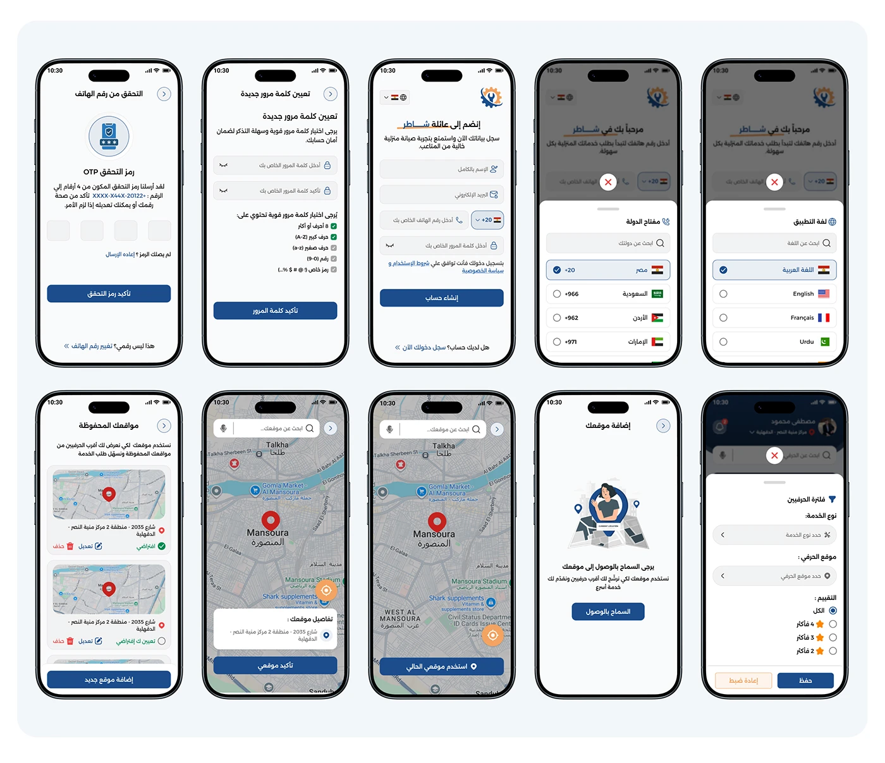

# Shater craftsman onboarding grid: OTP, password reset, country picker and saved-location map screens

**Discipline:** app · **Design type:** Onboarding screens · **Design style:** Corporate & Clean-Tech
**Tags:** onboarding, arabic, otp, map, location, password

## What it is
A grid of ten phone screens: phone-verification OTP, password reset with strength rules, a signup form, a country-code picker, a language picker, saved wallet locations with edit options, a live map pinning 'Mansoura', a location-permission prompt, and a service-request form with location and rating filters.

## What it means
Careful and secure; the explicit password rules and location permissions show attention to real-world account safety.

## Techniques
- State password rules directly on the reset screen.
- Ask for location permission with a friendly illustration before using it.
- Let saved locations be edited or set as default.

## Best for
- Account security flows
- Location-based service apps
- Onboarding UX documentation

## Vocabulary
- **Password strength rule** — Stated requirements for a valid password.
- **Permission prompt** — A screen asking for access to a device feature.
