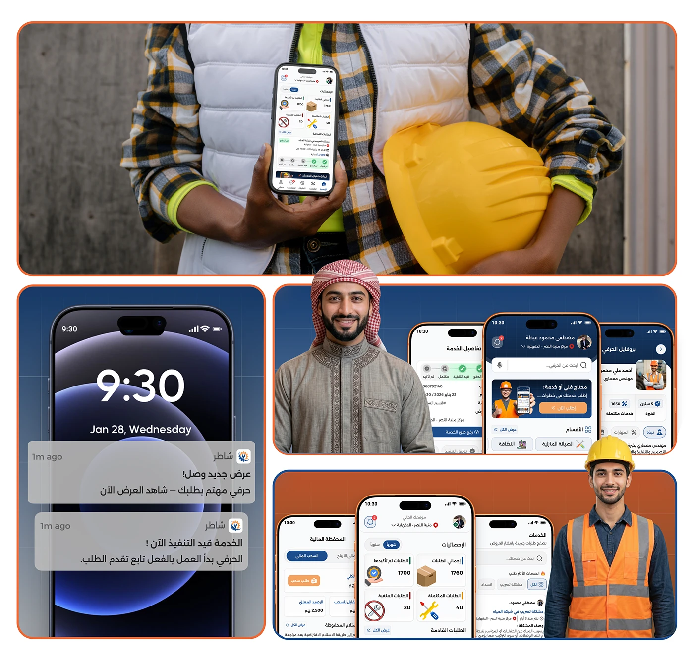

# Craftsman holding a phone and hard hat, beside two dark toast notification mockups and portrait photos

**Discipline:** app · **Design type:** Case study slide · **Design style:** Photographic & Cinematic
**Tags:** notifications, toast, arabic, craftsman, portrait, dark-ui

## What it is
A collage: a close crop of a craftsman in a flannel shirt holding both a phone and a yellow hard hat, a dark lock-screen phone showing two toast notifications ('New offer arrived!', 'Service in progress!'), and two more portrait photos of craftsmen each beside phone screens.

## What it means
Human and immediate; showing the notification on a lock screen makes the app's real-time updates feel tangible.

## Techniques
- Mock a notification on a realistic lock screen.
- Pair each persona photo with their relevant screens.
- Crop photos tightly for an intimate, documentary feel.

## Best for
- Notification design documentation
- Persona photography
- Real-time feature showcases

## Vocabulary
- **Toast notification** — A brief pop-up message that appears and fades.
- **Lock screen** — A phone's screen before it is unlocked.
