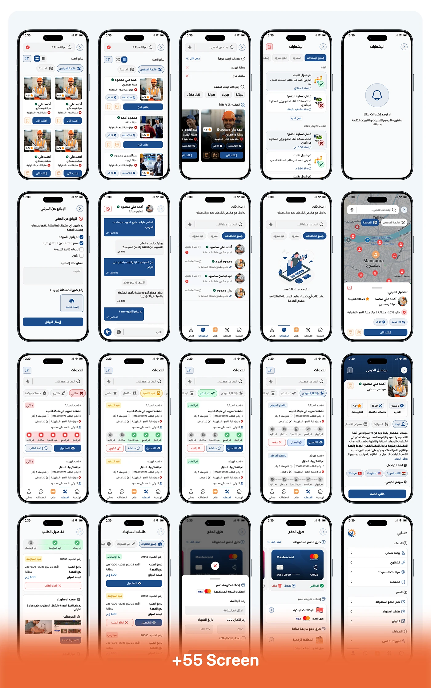

# Shater craftsman app: 20-screen grid covering search, chat, orders and payment, with '+55 Screen' banner

**Discipline:** app · **Design type:** UX documentation · **Design style:** Corporate & Clean-Tech
**Tags:** screens-grid, arabic, chat, payment, orange, case-study

## What it is
A 4x5 grid of Arabic phone screens: craftsman search and notifications, chat threads and offer negotiation, a map with location pins, service management and completed/failed orders, and payment method cards, closing with an orange '+55 Screen' banner.

## What it means
Comprehensive and confident; tiling dozens of real screens proves the flow was fully designed, not just imagined.

## Techniques
- Tile many real screens in a dense grid.
- Close a grid with a bold screen-count banner.
- Keep consistent phone frames across the grid.

## Best for
- Large app case studies
- Screen inventories
- Portfolio scale proof

## Vocabulary
- **Screen grid** — A tiled overview of many app screens.
- **Screen count banner** — A callout stating how many screens were designed.
