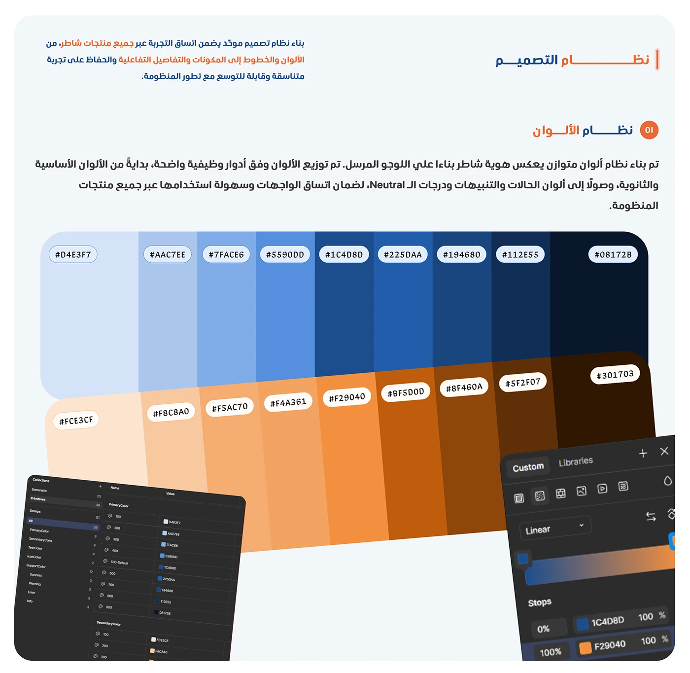

# Shater design system: blue and orange colour ramps with hex codes over a Figma colour-styles panel

**Discipline:** app · **Design type:** Design system documentation · **Design style:** Corporate & Clean-Tech
**Tags:** design-system, colour-palette, hex-codes, figma, blue, orange

## What it is
A light page with an Arabic 'نظام التصميم' (Design System) heading and intro, a 'نظام الألوان' (Colour System) subhead, two diagonal ramps of nine swatches each (blue #D4E3F7 to #08172B, orange #FCE3CF to #301703) with hex labels, and a cropped Figma panel showing colour variable groups and a gradient tool.

## What it means
Rigorous and scalable; naming every shade and showing the Figma source proves the system is built to last.

## Techniques
- Show a colour ramp from light to near-black.
- Label every swatch with its hex code.
- Include a screenshot of the actual design tool.

## Best for
- Design system documentation
- Style guides
- Token libraries

## Vocabulary
- **Colour ramp** — A sequence of a colour from light to dark.
- **Design token** — A named, reusable design value like a colour or spacing unit.
