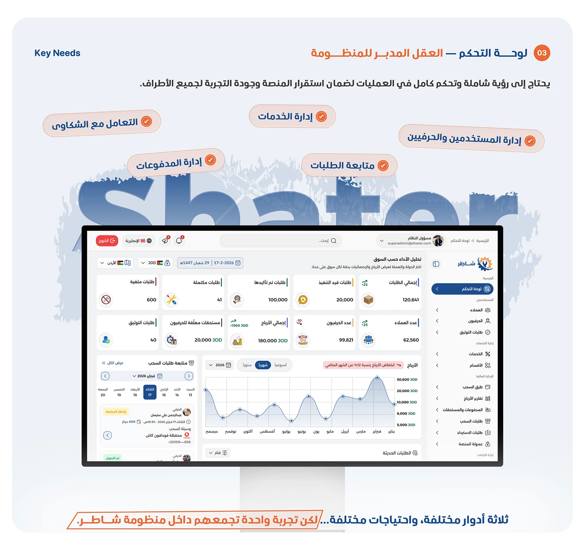

# 'Shater Marketplace Ecosystem' overview slide with a two-app explanation and a project-stats footer

**Discipline:** app · **Design type:** Case study intro slide · **Design style:** Corporate & Clean-Tech
**Tags:** overview, arabic, ecosystem, stats-footer, navy, case-study

## What it is
A light page with a '2026' date, 'نبذة عن شاطر — Shater Marketplace Ecosystem' heading, two paragraphs explaining the client and craftsman apps, two linked phone screens with curved arrows and app labels, a large 'شاطر' wordmark, a tagline, and a navy footer stating category, project type, 6-week duration and '260+ pages'.

## What it means
Scoped and credible; stating duration and page count upfront sets expectations before the deep dive begins.

## Techniques
- Open a case study by naming the whole ecosystem, not one app.
- Link two app screens with directional arrows.
- Close the intro with a stats footer bar.

## Best for
- Case study opening slides
- Project scope summaries
- Portfolio introductions

## Vocabulary
- **Ecosystem** — A set of connected products working together.
- **Stats footer** — A bottom bar stating key project facts.
