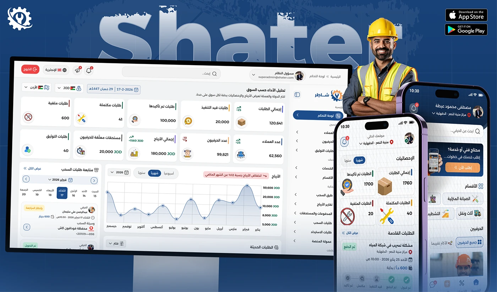

# Shater giant wordmark behind a desktop dashboard, phone and craftsman photo with App Store badges

**Discipline:** app · **Design type:** UX documentation · **Design style:** Corporate & Clean-Tech
**Tags:** hero, arabic, wordmark, desktop, store-badges, navy

## What it is
A navy cover with a huge diagonally-lit 'Shater' wordmark filling the top, a desktop admin dashboard on a monitor stand, two phone screens, a smiling craftsman in a hi-vis vest, and App Store / Google Play badges in the corner.

## What it means
Confident and complete; showing desktop, mobile and store badges together signals a finished, launched product.

## Techniques
- Fill the top of a cover with a giant lit wordmark.
- Combine desktop and mobile in one hero shot.
- Add store badges as proof of a real launch.

## Best for
- Case study cover slides
- Multi-platform product reveals
- Launch announcements

## Vocabulary
- **Store badge** — An official App Store or Google Play download button.
- **Diagonal lighting** — Light falling across type at an angle for drama.
