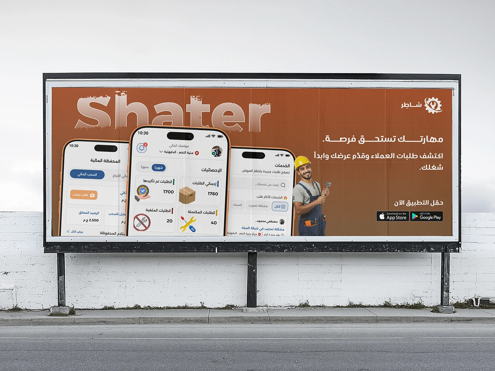

# Shater onboarding: hand-held hero phone above ten language, welcome and signup screens

**Discipline:** app · **Design type:** Onboarding screens · **Design style:** Corporate & Clean-Tech
**Tags:** onboarding, arabic, language-picker, signup, orange, hand-mockup

## What it is
A light page with a numbered 'تطبيق العميل' (Client App) title, a hand holding the app's home screen, and ten sequential onboarding screens below: two handshake intros, a notification preview, a feature carousel, a splash logo, welcome screens with phone-number and OTP fields, and a language picker listing Arabic, English, French, Urdu, Hindi, Bengali and more.

## What it means
Inclusive and thorough; a full language list signals the product was built for a genuinely international audience.

## Techniques
- Sequence onboarding screens left to right in reading order.
- Offer a wide language list with flags for recognition.
- Use OTP verification for a lightweight signup.

## Best for
- Onboarding flow documentation
- Multilingual apps
- Signup UX case studies

## Vocabulary
- **OTP** — One-time password sent to verify a phone number.
- **Language picker** — A screen for choosing the app's display language.
