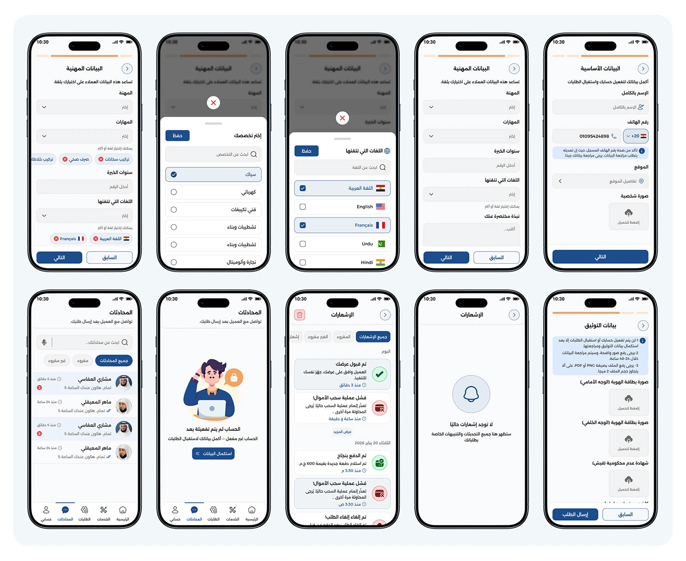

# Shater craftsman professional-data verification: profession, skills, languages and document-upload screens

**Discipline:** app · **Design type:** Onboarding screens · **Design style:** Corporate & Clean-Tech
**Tags:** verification, arabic, onboarding, documents, forms, craftsman

## What it is
A grid of ten phone screens covering professional data entry (profession, skills, years of experience, spoken languages with pill chips), messaging and notifications, and a document-upload form for national ID front/back and a criminal record certificate before final submission.

## What it means
Thorough and trustworthy; requiring real documents before activation shows the platform vets craftsmen seriously.

## Techniques
- Collect structured professional data as pill-chip selections.
- Require document uploads before granting full access.
- Pair form screens with the messaging and alerts they lead to.

## Best for
- Marketplace vetting flows
- Professional verification UX
- Two-sided platform onboarding

## Vocabulary
- **Vetting** — Checking a person's credentials before approval.
- **Pill chip selection** — Choosing multiple options shown as rounded tags.
