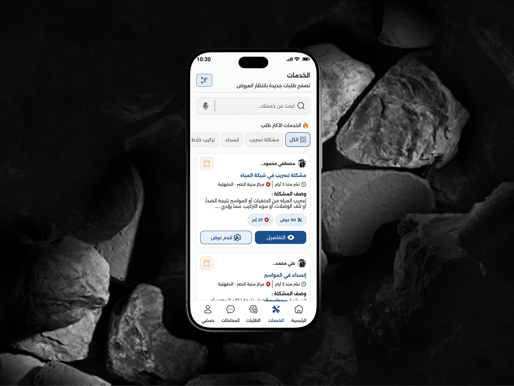

# Shater craftsman service-listing screen on a phone resting among dark grey stones

**Discipline:** app · **Design type:** Device mockup scene · **Design style:** Dark & Neon
**Tags:** mockup, dark, stone, service-list, arabic, phone

## What it is
A moody black-and-grey photo of jagged stones with a phone propped among them showing the craftsman's 'الخدمات' (Services) screen: a search bar, popular-service filter chips, and job cards with descriptions, price offers and action buttons.

## What it means
Rugged and grounded; the stone setting matches the trade (construction/repair) the app serves.

## Techniques
- Match the mockup's material to the app's industry.
- Desaturate the scene so the phone screen stays legible.
- Prop the phone naturally rather than floating it.

## Best for
- Trade and construction app mockups
- Mood-driven device shots
- Portfolio hero images

## Vocabulary
- **Prop mockup** — A device shown resting on a physical object rather than floating.
- **Filter chip** — A small toggle for narrowing a list.
