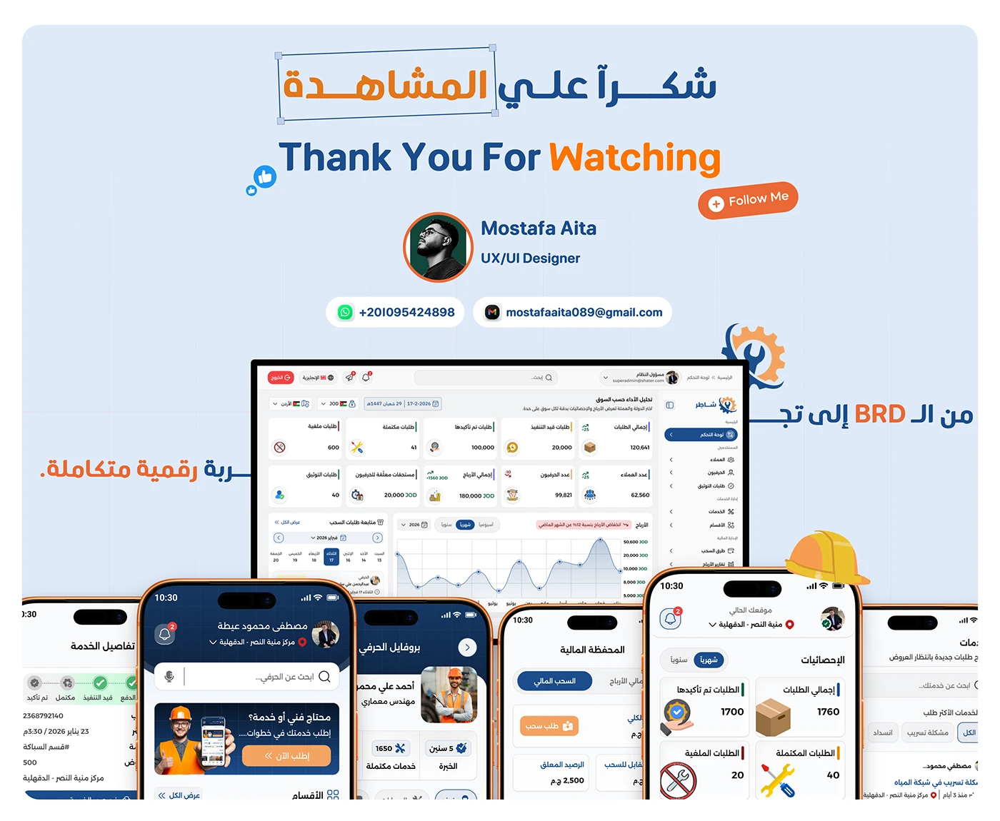

# Shater case study closing: bilingual 'Thank You For Watching' with a designer contact card and 'BRD to' tagline

**Discipline:** app · **Design type:** Case study closing slide · **Design style:** Corporate & Clean-Tech
**Tags:** closing-slide, arabic, bilingual, contact-card, blue, case-study

## What it is
A light blue closing slide with a boxed Arabic 'شكراً علي المشاهدة' above 'Thank You For Watching', a designer contact card (photo, name, role, WhatsApp, email, 'Follow Me' button), an Arabic tagline 'من الـ BRD إلى تج...' and a dashboard-plus-phones cluster with a hard-hat icon.

## What it means
Professional and personal; a real contact card turns a portfolio ending into an invitation to connect.

## Techniques
- Close bilingually for a wider audience.
- Include a full contact card with a follow CTA.
- Reuse hero screens small as a closing visual.

## Best for
- Bilingual case studies
- Freelance designer portfolios
- Closing slides

## Vocabulary
- **Contact card** — A block with photo and ways to reach someone.
- **Bilingual layout** — Content shown in two languages together.
