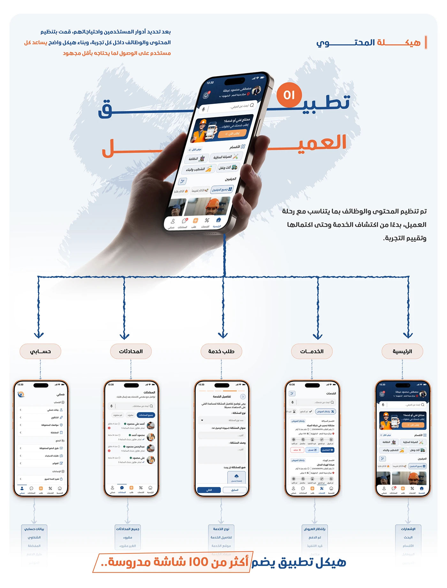

# Shater process methodology: three circled phase icons (Requirements, UX, Design) each with pill task tags

**Discipline:** app · **Design type:** UX documentation · **Design style:** Corporate & Clean-Tech
**Tags:** methodology, process, arabic, icons, pills, orange

## What it is
A light page with 'منهجية العمل والخطوات' (Work Methodology and Steps) and an intro, three columns each headed by a circled icon (document, clock, brush) labelled 'المتطلبات' (Requirements), 'فهم وبناء التجربة' (Understand & Build Experience) and 'التصميم' (Design), each with two or three pill task tags below, over screens of the finished product.

## What it means
Transparent and methodical; naming each phase's concrete tasks makes the process feel rigorous, not just decorative.

## Techniques
- Represent each process phase with one icon and a name.
- List concrete tasks as pill tags under each phase.
- Preview the outcome faintly behind the process diagram.

## Best for
- Case study process slides
- Design methodology documentation
- Client-facing process explainers

## Vocabulary
- **Process phase** — A distinct stage in a project's workflow.
- **Pill tag** — A small rounded label for a short term.
