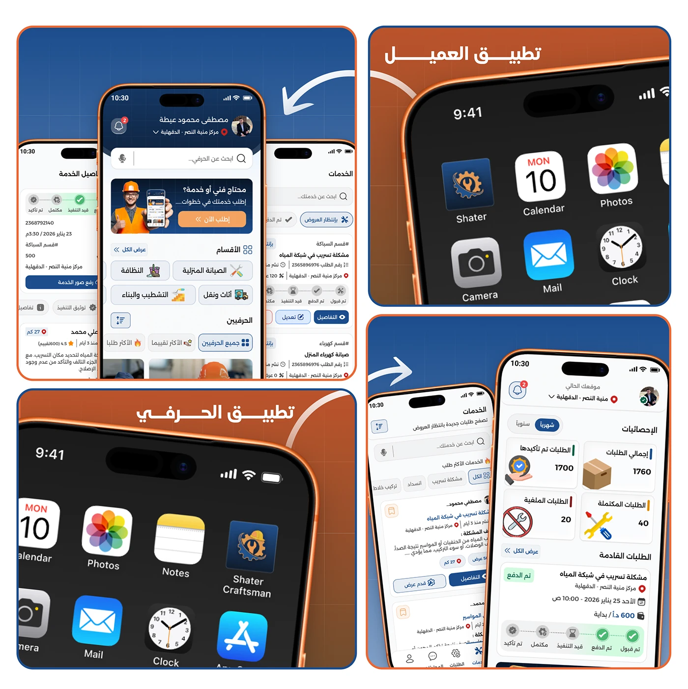

# Shater client and craftsman apps shown installed side by side on an iPhone home screen

**Discipline:** app · **Design type:** Case study slide · **Design style:** Corporate & Clean-Tech
**Tags:** app-icons, home-screen, arabic, blue, orange, case-study

## What it is
Two cropped iPhone home screens on orange: one labelled 'تطبيق العميل' (Client App) with the blue Shater icon among Calendar, Photos, Camera and Mail; the other 'تطبيق الحرفي' (Craftsman App) with an orange 'Shater Craftsman' icon in the same layout, plus supporting app screenshots beside each.

## What it means
Real and installable; seeing both icons live on a phone's home screen proves the two-app strategy actually shipped.

## Techniques
- Distinguish sibling apps with a different icon colour.
- Show the icon in situ among familiar system apps.
- Pair each home screen with its in-app UI beside it.

## Best for
- Multi-app product launches
- App icon presentations
- Case study proof slides

## Vocabulary
- **App icon** — The small image representing an app on a home screen.
- **In situ mockup** — Showing a design in its real, expected context.
