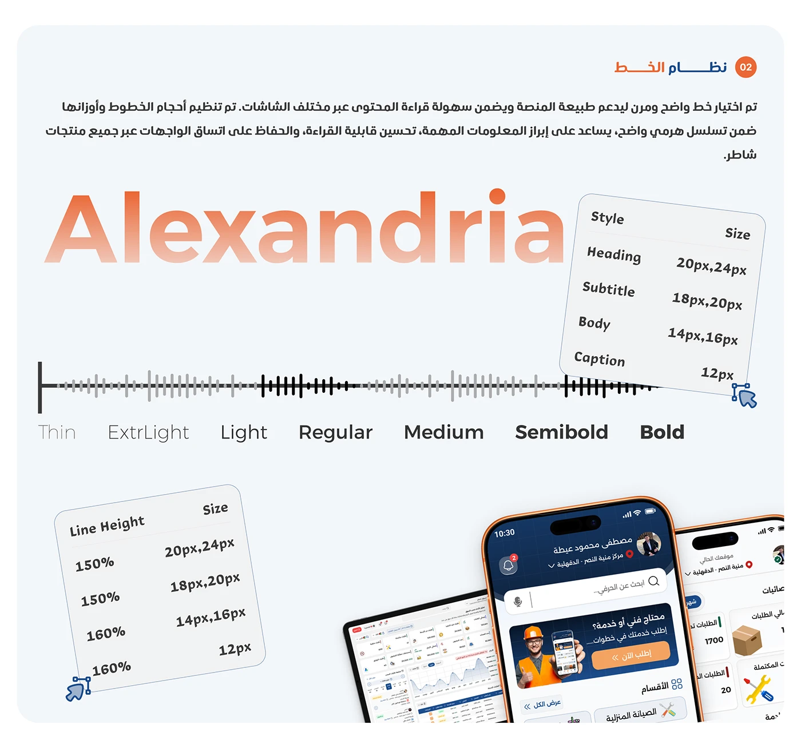

# Shater typography system: 'Alexandria' font specimen with weight scale, size table and line-height table

**Discipline:** app · **Design type:** Design system documentation · **Design style:** Corporate & Clean-Tech
**Tags:** design-system, typography, font-specimen, arabic, orange-gradient

## What it is
A light page with an Arabic 'نظام الخط' (Type System) heading and rationale, a huge orange-gradient 'Alexandria' wordmark, a weight scale from Thin to Bold rendered as a waveform-like bar chart, a size table (Heading 20-24px, Subtitle 18-20px, Body 14-16px, Caption 12px) and a line-height table, with app screens below.

## What it means
Systematic and considered; visualising weights as a waveform makes an otherwise dry type scale memorable.

## Techniques
- Render a font-weight scale as a bar-height waveform.
- Pair size and line-height in matching small tables.
- Show the typeface name itself in a gradient as the hero.

## Best for
- Design system typography pages
- Style guides
- Type scale documentation

## Vocabulary
- **Type scale** — The set of font sizes used across an interface.
- **Font weight** — How thick or thin a typeface's strokes are.
