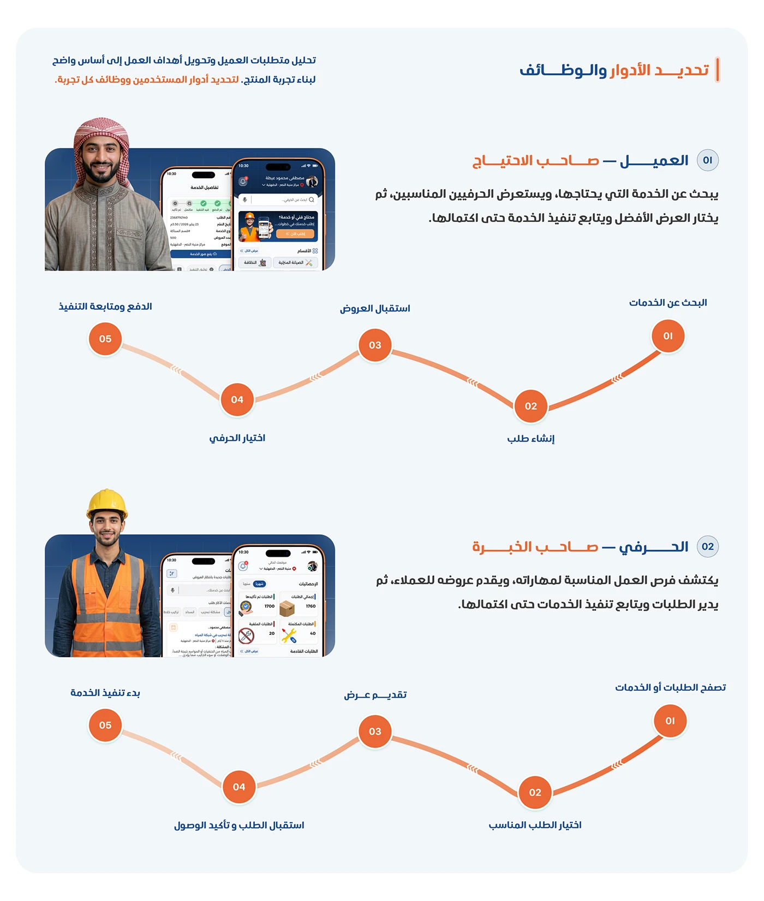

# Shater user roles: client and craftsman journey maps as orange numbered stepping-stone paths

**Discipline:** app · **Design type:** UX documentation · **Design style:** Corporate & Clean-Tech
**Tags:** user-roles, journey-map, arabic, orange, persona, ux-research

## What it is
A light page with an Arabic 'تحديد الأدوار والوظائف' (Defining Roles and Functions) heading, two persona blocks (Client — the one with the need; Craftsman — the experienced one) each with a photo, phone screens and a five-step zig-zag journey path (search, create request, receive offers, choose craftsman, pay and track).

## What it means
Grounded and clear; the zig-zag path turns an abstract user journey into a simple walk with five stops.

## Techniques
- Map a journey as a zig-zag path of numbered stops.
- Pair each persona with their own device screens.
- Repeat the same path shape for every persona.

## Best for
- UX research documentation
- Multi-role platforms
- Journey mapping

## Vocabulary
- **Journey map** — A visual sequence of a user's steps toward a goal.
- **Stepping-stone path** — A zig-zag line connecting sequential steps.
