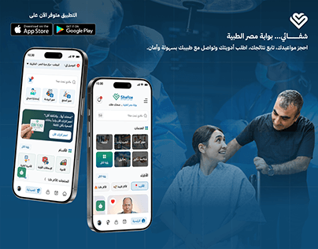

# Shefaa Arabic medical app cover: two phones over a blue-tinted hospital photo with store badges

**Discipline:** app · **Design type:** Device mockup scene · **Design style:** Corporate & Clean-Tech
**Tags:** health, arabic, blue, hospital, app-store, case-study-cover

## What it is
A cover with a blue-tinted photo of a doctor helping a patient, two phones showing an Arabic health home screen (services grid, doctors, banners), App Store and Google Play badges, a heart-shield logo and an Arabic tagline.

## What it means
Caring and reliable; the real clinic photo grounds the app in human care.

## Techniques
- Tint a background photo in the brand blue.
- Float two phones at slightly different angles.
- Add store badges to signal a real product.

## Best for
- Health apps
- Arabic-market apps
- Launch covers

## Vocabulary
- **Store badges** — Official App Store and Google Play buttons.
- **Colour tint** — A single colour laid over a photo.
