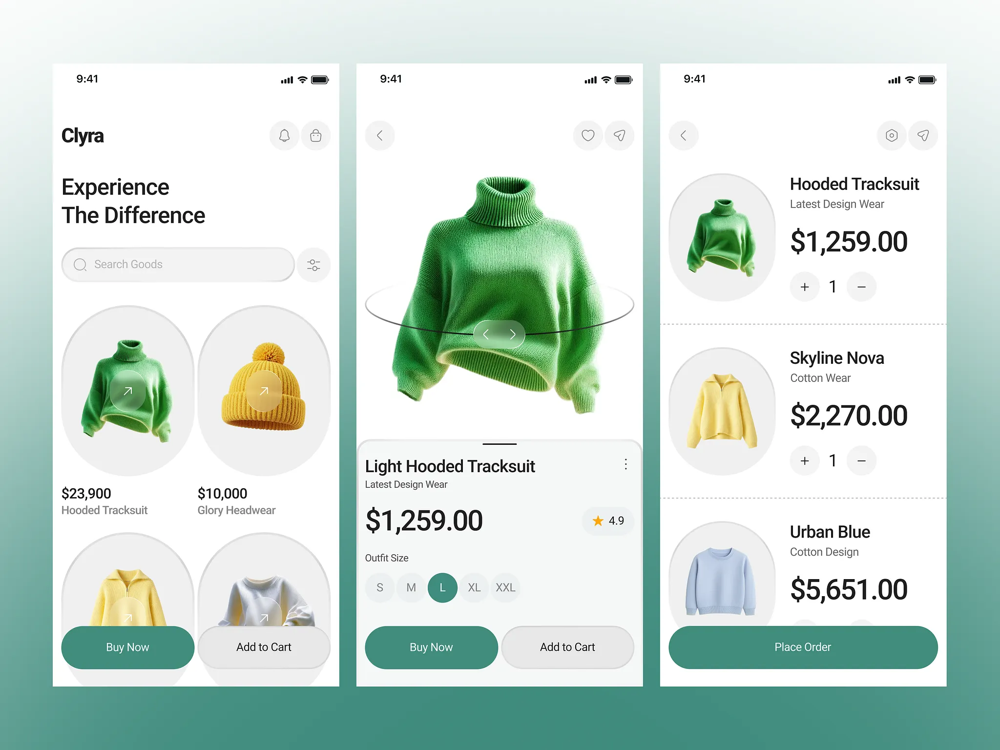

# Fashion shopping app screens with knitwear cutouts in oval frames on a teal gradient

**Discipline:** app ·  · **Design style:** Gradient & Aurora
**Tags:** shopping, fashion, teal, oval-frames, rotate-view, green-buttons, white-ui, three-screens

## What it is
Three white phone screens on a teal gradient. The first has a search field and two-column oval product frames with round arrow buttons and prices; the second a large knitwear image with a 360-degree ring, size pills and Buy Now / Add to Cart buttons; the third a cart list with dashed dividers and quantity steppers.

## What it means
Soft, tidy and modern; ovals and pill buttons make shopping feel gentle.

## Techniques
- Frame each product in a tall oval instead of a square.
- Show a rotation ring around the hero product.
- Use one deep teal for primary buttons and selected states.
- Divide cart rows with dashed rules.

## Best for
- Fashion and lifestyle shopping apps
- Soft, rounded UI systems
- Presentations on gradient backdrops

## Vocabulary
- **Oval frame** — A tall elliptical container for a product image.
- **Rotation ring** — A ring graphic implying the object can be spun.
- **Quantity stepper** — Plus and minus controls around a number.
- **Dashed divider** — A dotted rule separating list items.
