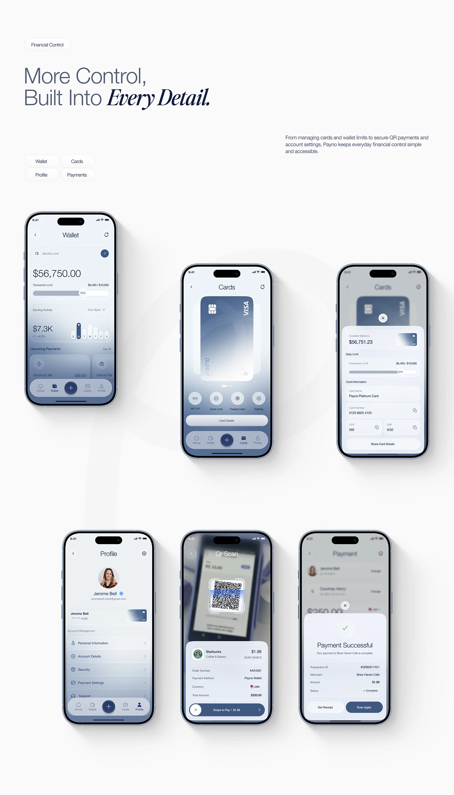

# Six Fintech Screens with Control Headline

**Discipline:** app ·  · **Design style:** Editorial
**Tags:** fintech, screens, serif-italic, blue-grey, wallet, cards, qr, payment

## What it is
A pale page with a Financial Control pill, a headline mixing light sans and bold italic serif 'Every Detail.', a paragraph, four tag pills and six phones in two rows: wallet, cards, card details sheet, profile, QR scan and payment successful, all in blue-grey gradients.

## What it means
A consistent gradient rising in each screen and shared bezels give six functions one calm voice.

## Techniques
- Blue-grey gradient rising from each screen base
- Bottom sheets rising over blurred screens
- Hatched progress bar for limits
- Staggered layout of phones in two rows
- Pill tags summarising the section

## Best for
- Fintech flow presentations
- Card and wallet app screens
- Serif-accent headline pages

## Vocabulary
- **Bottom sheet** — A panel rising from the bottom over a dimmed screen.
- **Hatched bar** — A bar filled with fine diagonal lines.
- **Tag pills** — Small rounded labels naming topics.
