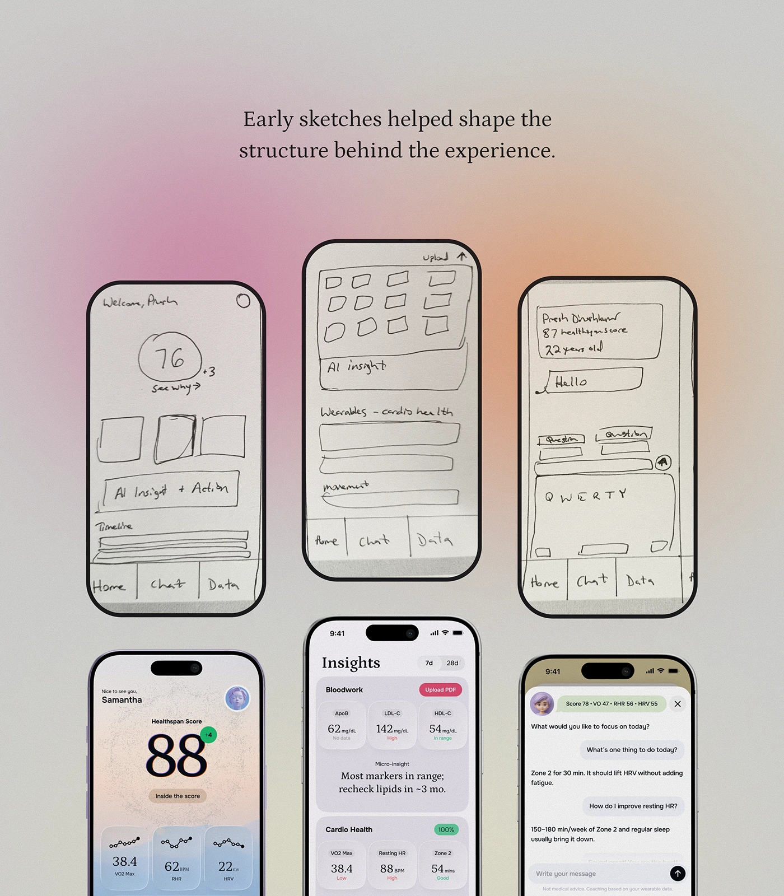

# Hand sketches beside final screens on a blurred gradient

**Discipline:** app · **Design type:** Design process showcase
**Tags:** process, wireframes, sketches, phone-mockup, gradient-blur, case-study, health

## What it is
A case-study slide with a serif caption, and a two-row grid of phones: the top row shows hand-drawn paper wireframes inside phone frames; the bottom row shows the finished screens (score, insights, chat). The backdrop is a soft pink and orange gradient blur.

## What it means
Transparent, human and craft-focused; showing the sketch beside the result builds trust in the design thinking.

## Techniques
- Place raw sketches in the same device frame as final screens so evolution reads instantly.
- Use a soft aurora gradient behind neutral grey to add warmth without noise.
- Centre a short serif caption above to tell the story in one line.
- Arrange phones in a staggered grid so rows imply a journey from idea to product.

## Best for
- UX case studies and portfolios
- Process storytelling in pitches
- Design system or product launch write-ups

## Vocabulary
- **Wireframe** — A simple structural sketch of a screen without visual styling.
- **Aurora gradient** — A blurred multi-colour glow used as a backdrop.
- **Device frame** — A phone outline placed around a screen.
- **Process shot** — An image showing the steps behind a design.
